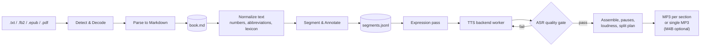

# Text2Audio — Offline Document-to-Audiobook Pipeline

**Project Specification**

| | |
|---|---|
| Document version | 1.16-M2 |
| Status | **Approved for M0** (open decisions in §13.1) |
| Last updated | 2026-10-26 |
| Primary language | Python 3.11+ |
| Usage / license | **Personal use only** — license is not a selection criterion (§13.1, ADR-0007) |

**Change log**

| Version | Date | Summary |
|---|---|---|
| 0.1 | 2026-10 | Initial draft. |
| 0.2 | 2026-10-24 | Refreshed TTS model catalog (Kokoro / Chatterbox replace XTTS-v2 / Bark as defaults); added EPUB input, segment manifest, plugin-by-entry-point and isolated backend workers, ASR quality gate, M4B output, loudness targets, hardware tiers, measurable NFRs, security section, glossary and references. |
| 0.3 | 2026-10-24 | MP3 is the default output format; M4B becomes optional. Added automatic splitting into one file per book section with sanity checks and fallback to a single file (§6.8.1). |
| 0.4 | 2026-10-24 | One folder per book under the output root, named after the input file name; work files moved to `_work/`; batch conversion (§5.2, FR-21). |
| 0.5 | 2026-10-24 | Zero-config quality: automatic decisions, per-language profiles (English, Russian, generic fallback) and content profiles supply the defaults when `text2audio.toml` is empty (§6.6.5, FR-22). |
| 0.6 | 2026-10-24 | **Decision:** Russian confirmed as the second language (M4). Added decision log (§13.1). |
| 0.7 | 2026-10-24 | Russian research: stress (RUAccent default), normalization (rutextnorm, to be audited), per-language QA ASR (GigaAM-v3 for Russian), Russian backend shortlist with license notes, offline asset checklist and M4 benchmark protocol (§6.6.5, §8). |
| 0.8 | 2026-10-24 | **Principle: no universal model.** Every language-dependent pipeline stage is pluggable per language (§6.6.1); per-language component matrix; mixed-language routing across different backends; per-language overrides in config; install only the languages you need. |
| 1.0-M0 | 2026-10-24 | Approved for M0. License default recorded as proposed (MIT core). Companion docs added: README, CLAUDE.md, CONTRIBUTING, CHANGELOG, ADRs 0001–0006, `docs/adding-a-language.md`. |
| 1.1-M0 | 2026-10-24 | **Decision:** personal use only. Component priority is offline → quality → everything else; licenses are informational. Non-commercial models (IndexTTS-2, XTTS-v2, ESpeech, Silero v5, MMS) become full candidates; PDF reader chosen by M1 benchmark; licensing risk removed. |
| 1.2-M0 | 2026-10-24 | **Decision:** Russian is the **first** language (M2), English second (M4) — ADR-0008. Russian benchmark protocol moves to M2; isolation proof (FR-07) moves to English. QA gate (§6.9) made per-language; pack paths aligned with §10. |
| 1.3-M0 | 2026-10-24 | Editable Markdown `<book>.md` moves next to the audio; the original input is always copied into `_work/` for re-conversion (`convert --reconvert`); `.md` accepted as input (§5.2, FR-01, FR-08). M0 implementation feedback: backend descriptor + `WorkerBackend` split (§6.6.2), protocol details (§6.6.3), resource planning (§9.1, `text2audio resources`, `[resources]` config). **Decision:** covers — extract, else generate with a local Stable Diffusion WebUI started on the first GPU with enough free VRAM, else typographic (§6.8.2, FR-23, ADR-0009); loopback-only local-service exception (§6.10). |
| 1.4-M0 | 2026-10-24 | Russian smoke spike results: Silero v5.6 `xenia` (female) is the fast-tier candidate; normalization mandatory (Silero drops digits); QA uses GigaAM-v3 branch `rnnt` (spoken form); RUAccent must be wrapped to stay offline. `models.lock` gains `url` assets; `install.sh` pulls every pinned weight. |
| 1.5-M0 | 2026-10-25 | Polish spike (`ru-polish`) + owner listening: **Decision:** Russian T1 is a hybrid — Silero → Chatterbox VC for Cyrillic-only segments (Chatterbox TTS quality at 1/6 of the time, no word errors), Chatterbox Multilingual TTS for segments with Latin-script words; enhancement on 48 kHz Silero dropped; VC is GPU-only; QA gate cannot see stress changes (§6.6.6). Russian text with English terms recorded as an open M2 question. |
| 1.6-M0 | 2026-10-25 | **Foreign-script spans** inside a sentence (FR-24): the core tags them by Unicode script, the language pack resolves them; Russian rules for Latin-script words (§6.6.5). **Decision:** Russian narrator voice is Silero `xenia`; Chatterbox clones it from a pinned `xenia` reference clip. Russian backend tables (§6.6.1, §6.6.5, §8, §9, M2) aligned with the decisions; workflow: commits go straight to `main`. |
| 1.7-M1 | 2026-10-25 | M1 implementation feedback: readers as built (§6.3: TOC-driven EPUB chapters, FB2 banners/dinkus/wrapper rules, TXT layouts and confidence, PDF clean-up); XML through defusedxml with an HTML-entity pass, no lxml (§6.12, §7); **PDF default pymupdf4llm 1.28.2 with its bundled layout model** (benchmark `spikes/pdf-readers`); rule-based sentence splitting with pack abbreviations instead of pySBD (§6.5); the `ru` pack exists from M1 with text-structure data. |
| 1.8-M2 | 2026-10-25 | M2 step 1 (first audiobook on CPU): **rutextnorm rejected** after the audit — the `ru` pack owns its normalization (rules + num2words + pymorphy3, §6.6.5); lexicon applied **before** normalization (§6.5); plugin worker environments outside the repo, Python 3.12, stdlib worker runtime with a network guard (§6.6.3, ADR-0010); manifest fields `heading_level`, `text_stress`, `route`, `duration_ms` and the resumable journals `render.jsonl` / `stress.jsonl` (§5.2, §6.4.2); long sections split at lower headings are **grouped** into files near the target length (§6.8.1); Silero runs on CPU slots, at most 8 workers by default (§9.1). |
| 1.9-M2 | 2026-10-25 | Progress display for `run` / `synthesize` (FR-17, §6.11): `rich` stage lines + live bar on stderr, results on stdout; `Progress` callables may add `detail(stage, **fields)`; Ctrl-C exits 130. |
| 1.10-M2 | 2026-10-25 | M2 step 2: QA gate as built (§6.9) — GigaAM-v3 worker, WER **and** CER rule, signal checks, up to 3 attempts, exit code 4; QA results in `render.jsonl` (§6.4.2); `.srt` per MP3 (§6.8) and `report.md` (§5.2); parallel part encoding and RUAccent workers; T0 numbers (§9). |
| 1.11-M2 | 2026-10-25 | M2 step 3a: FR-24 Latin-script spans as built (§6.6.5) — acronyms spelled as one word («эйчтитипи́»), T0 transliteration through `espeak-ng` English IPA → Cyrillic; `report.json` `foreign_spans`. **Decision:** FR-24 acceptance is "no segment flagged by the QA gate and no unresolved span", not WER 0 — GigaAM-v3 cannot write English-sounding words; the QA gate lists such readings as `unverified` instead of scoring them (§6.9, §13.1). |
| 1.12-M2 | 2026-10-26 | M2 step 3b: the Russian T1 hybrid as built (§6.6.6) — `chatterbox` backend + polisher plugin, per-segment routes, fast-tier audio reused as VC source, `polish` stage, unpolished fallback on the last QA attempt; reference clip in the `ru` pack; T1 reference limits (§9, §13.1). |
| 1.13-M2 | 2026-10-26 | T1 `ru` measured on the full novel (§9, §13.1); owner's QA limit — at most 100 segments checked per run, polish/QA in batches of ≤ 100 — recorded as proposed (§6.9). |
| 1.14-M2 | 2026-10-26 | M2 step 4a: compound hyphens lost at PDF line ends are restored by `ru` normalization — only words pymorphy3 does not know (§6.3, §6.6.5, §13.1). |
| 1.15-M2 | 2026-10-26 | M2 step 4b — **Decision:** QA limit as built: at most 100 segments checked per run (`[qa] max_segments`, `--qa-max`), the first in hash order; polish and QA run in batches of ≤ 100 segments on worker pools kept loaded; the M2 flagged-share criterion is measured over the checked sample (§6.9, §11, §13.1). |
| 1.16-M2 | 2026-10-26 | M2 step 4c — covers as built (§6.8.2): typographic covers with bundled DejaVu Serif; `sd-webui` generator on a private WebUI instance (own data dir, the WebUI's default checkpoint); **Decision:** cover prompts of non-English books are translated offline by an Opus-MT `translators` component pinned in `models.lock` (closes the open §13.1 row); `[cover]` / `[cover.sd]` config; `doctor` covers line. |

The key words **MUST**, **SHOULD** and **MAY** are used as described in
[RFC 2119](https://www.rfc-editor.org/rfc/rfc2119).

---

## 1. Executive Summary

Text2Audio is an **offline, multi-language document-to-audiobook pipeline**. It
converts documents — **plain text (`.txt`), FictionBook (`.fb2`, `.fb2.zip`), EPUB
(`.epub`) and PDF (`.pdf`)** — into clean, human-editable **Markdown**, and then
synthesizes that Markdown into an **audiobook (MP3 by default, one file per book
section where the structure allows it)** using local neural
text-to-speech (TTS) models.

Design pillars:

1. **Offline by contract** — after installation, no network access is needed or
   attempted. Air-gapped installation is supported through an exportable bundle.
2. **Best-of-breed per language** — there is no single model that is best for every
   language, so each language chooses its own TTS model **and** its own text
   processing, stress/G2P, quality-check ASR and emotion components. Each language and
   each model ships as an independent, installable package that can live in its own
   repository and its own Python environment.
3. **Expressive, not monotone** — a layered expression system goes from cheap
   structural prosody (pauses, voice changes for dialogue) up to emotion-aware
   synthesis on backends that support it.
4. **Verifiable quality** — every synthesized segment is checked automatically
   (speech recognition round-trip) and re-generated if the model skipped, repeated or
   invented words.

---

## 2. Problem Statement

- E-books and documents exist in many formats (FB2, EPUB, PDF, TXT) that are not
  directly consumable as audio.
- High-quality TTS is mostly cloud-based: it requires a network connection, has
  per-character costs, and sends document content to third parties.
- Users want a **private, reproducible, offline** way to turn documents into
  audiobooks in **their own language**.
- Naive TTS reads text monotonically and mispronounces numbers, abbreviations and
  names; a good audiobook needs **text normalization, pacing, voice variety and
  emotional expression**.
- Modern autoregressive TTS models occasionally **hallucinate** (skip, repeat or invent
  words); at book length this is guaranteed to happen and must be detected.

---

## 3. Goals and Non-Goals

### 3.1 Goals

1. Convert `.txt`, `.fb2`, `.epub` and `.pdf` into normalized Markdown.
2. Synthesize high-quality speech from Markdown, **entirely offline**.
3. Support **multiple languages**: **Russian first** (M2), English second (M4).
4. Allow new languages and models to be added as **independent packages** without
   modifying the core, with **a different model family and toolchain per language**
   where that gives better results.
5. Provide **layered expression** support (structural → inferred → manual).
6. Produce audiobook output as **MP3 by default**, split into **one file per book
   section** when the structure is reliable, otherwise a single file; **M4B**, Opus and
   WAV are optional.
7. One-command bootstrap that installs dependencies and downloads all weights, leaving
   the project fully offline-capable.
8. **Best possible result with zero configuration**: with an empty `text2audio.toml`,
   the language profile, content detection and installed hardware decide every
   setting; configuration only overrides.

### 3.2 Non-Goals (v1)

- Cloud or streaming TTS, or any runtime network dependency.
- Real-time / low-latency synthesis (batch processing is sufficient).
- DRM-protected or encrypted documents.
- OCR of scanned PDFs (deferred to v2 — see §11).
- GUI (CLI + Python API only in v1).
- Music, sound effects, or full audiobook mastering/mixing.
- Training or fine-tuning TTS models (only inference on published weights).
- Commercial use or redistribution of generated audio or bundled models (personal use
  only — see ADR-0007).

---

## 4. Users and Use Cases

| Persona | Need | Key requirements |
|---|---|---|
| **Reader / listener** | Turn a personal e-book library into audiobooks, privately. | FR-01..FR-06, NFR-01 |
| **Editor / producer** | Fix pronunciation, assign voices, tune emotion, re-render only changed parts. | FR-08, FR-10, FR-13, FR-14 |
| **Language contributor** | Add a new language or model without learning the core codebase. | FR-07, §6.6 |
| **Operator (air-gapped site)** | Install on a machine that never touches the internet. | FR-04, FR-16, §6.10 |

---

## 5. System Overview

### 5.1 Pipeline



| Stage | Responsibility | Artifact |
|---|---|---|
| **Detect & Decode** | Detect format by content (magic bytes / XML root / zip contents), detect encoding, unpack archives safely. | — |
| **Parse to Markdown** | Extract structure (chapters, headings, paragraphs, emphasis, quotes, poetry, footnotes) and metadata (title, author, language, cover). | `<book>.md` (the editable book text, "`book.md`" below) + `metadata.json` + `cover.jpg` |
| **Normalize text** | Language-specific verbalization of numbers, dates, units, abbreviations; apply pronunciation lexicon; resolve foreign-script spans (FR-24). | (in-memory) |
| **Segment & Annotate** | Split into synthesis units that fit the backend's input limit; attach voice, language, pause and expression attributes. | `segments.jsonl` |
| **Expression pass** | Map structural / inferred / manual expression to the backend's control vocabulary. | updates `segments.jsonl` |
| **TTS backend worker** | Synthesize each segment in an isolated process. | `audio/segments/*.wav` |
| **Polish** *(optional)* | Improve the synthesized audio without changing its words: voice conversion to a more natural target voice, or enhancement / super-resolution (§6.6.6). | `audio/polished/*.wav` |
| **ASR quality gate** | Transcribe each segment (after polish, if any), compare to source, retry failures. | `report.json` |
| **Assemble** | Insert pauses, concatenate, normalize loudness, decide the split plan (§6.8.1), encode, write tags. | `<output root>/<book>/*.mp3` (+ optional `.m4b`) |

### 5.2 Output layout (one folder per book)

All results go under an **output root** (default `./output`, set with `-o` or
`output.root`). Each input file gets **its own book folder, named after the input
file name**. The finished audio sits at the top of the book folder, ready to copy to a
player; everything needed to edit and resume lives in `_work/`.

```text
output/                                  # output root
├── War and Peace/                       # from "War and Peace.fb2.zip"
│   ├── 01 - Book One, Chapter 1.mp3     # one MP3 per section (split mode)…
│   ├── 01 - Book One, Chapter 1.srt     # …each with subtitles: the book text, timed
│   ├── 02 - Book One, Chapter 2.mp3
│   ├── …
│   ├── War and Peace.m3u                # playlist in reading order
│   ├── War and Peace.m4b                # optional, only if enabled
│   ├── War and Peace.md                 # editable Markdown text — edit, then re-run
│   ├── report.json                      # QA results, timings, split decision, warnings
│   ├── report.md                        # the same, readable: files, QA flags, timings
│   └── _work/                           # resumable workspace
│       ├── text2audio.toml              # per-book settings (voices, expression, output)
│       ├── source.fb2.zip               # copy of the original input, for re-conversion
│       ├── book.converted.md            # last converter output, to diff against edits
│       ├── metadata.json                # title, author, language, cover, source hash
│       ├── cover.jpg
│       ├── lexicon.tsv                  # per-book pronunciation overrides
│       ├── segments.jsonl               # segment manifest (§6.4.2)
│       ├── render.jsonl                 # journal of rendered segments (resume, FR-10)
│       ├── stress.jsonl                 # cache of stress-marked text
│       ├── parts.json                   # fingerprints of the output files (re-encode only changes)
│       └── audio/
│           ├── segments/                # one file per segment, named by content hash
│           └── chapters/                # assembled per-section WAV (intermediate)
├── moby-dick/                           # from "moby-dick.epub"
│   └── …
└── report (pdf)/                        # from "report.pdf" when "report.txt" also exists
    └── …
```

**Folder naming rules**

1. **Name = input file name without its format extension(s)**: `War and Peace.fb2.zip`
   → `War and Peace`, `notes.txt` → `notes`. Known compound extensions
   (`.fb2.zip`) are stripped as one.
2. **Sanitized, not transliterated**: Unicode (e.g. Cyrillic) names are kept;
   characters invalid on common filesystems (`/ \ : * ? " < > |`, control characters)
   become `_`; leading/trailing dots and spaces are trimmed; length is capped at 120
   bytes. `--name <folder>` overrides the derived name.
3. **Same source again → same folder.** If the folder exists and
   `_work/metadata.json` has the same source hash, the run **resumes** in it (FR-10).
4. **Name clash with a different source:**
   - same name, different format (`report.txt` and `report.pdf` in one batch) →
     the format is appended: `report (pdf)`;
   - same name and format, different content → a counter is appended:
     `notes (2)`, unless `--overwrite` is given.
5. **Batch input**: several files or a directory (`text2audio run books/`) produce one
   book folder per supported file; one failing book does not stop the others, and a
   summary lists each book's folder and status.

**Editing and re-conversion**

- The editable Markdown sits **next to the audio** as `<book folder name>.md`, so it is
  easy to find, open and keep with the audiobook. Editing it and running
  `synthesize` (or `run`) again re-renders only the changed segments (FR-08, FR-10).
- The original input is always **copied** (not linked) to `_work/source.<ext>`, so the
  book can be converted again after the original moves, or with a better reader
  (e.g. a different PDF reader after the M1 benchmark): `text2audio convert
  --reconvert <book folder> [--reader <name>]`.
- `_work/book.converted.md` keeps the last converter output. On re-conversion, if
  `<book>.md` differs from it (the user edited it), the new output goes to
  `<book>.reconverted.md` and the user's file is left untouched; otherwise `<book>.md`
  is replaced. The reader name and version are recorded in `metadata.json`.
- A `.md` input (already in the §6.4.1 dialect, e.g. a file edited elsewhere) is
  accepted as is.

Final file names inside the book folder follow §6.8 (`NN - <Section title>.mp3`,
`<book folder name>.m3u`, `<book folder name>.m4b`).

---

## 6. Specification

### 6.1 Functional Requirements

| ID | Requirement | Priority | Acceptance criteria |
|---|---|---|---|
| FR-01 | Accept `.txt`, `.fb2`, `.fb2.zip`, `.epub`, `.pdf` and `.md` (§6.4.1 dialect) and detect the format by content, not only by extension. | Must | A renamed file (e.g. `.fb2` saved as `.txt`) is detected correctly in tests. |
| FR-02 | Convert each format to normalized Markdown (§6.4.1), preserving chapters, headings, paragraphs, emphasis, block quotes, epigraphs, poetry and footnotes. | Must | Golden-file tests pass for every format; chapter count matches the source TOC. |
| FR-03 | Extract metadata: title, author(s), language, series, cover image. | Must | Metadata from FB2 `<title-info>` and EPUB OPF appears in `metadata.json` and in output tags. |
| FR-04 | Run **100% offline** after installation. | Must | Full test suite passes inside a network namespace with no interfaces (§12). |
| FR-05 | Provide a CLI (§6.11) and an importable Python API with the same capabilities. | Must | Every CLI command has an equivalent public API function covered by tests. |
| FR-06 | Support **Russian** (M2) and **English** (M4) end-to-end in v1, on both hardware tiers (§9). | Must | A Russian and an English audiobook are produced from each input format on T0 and T1 hardware. |
| FR-07 | Discover languages, TTS backends and per-stage components (normalizer, G2P/stress, ASR, emotion) as **plugins via Python entry points** (§6.6.1); each language may use a different implementation for every stage; adding one requires no core change. | Must | English is added in M4 (after Russian) with zero diff under `src/text2audio/core/`. |
| FR-08 | Persist the editable `<book>.md` next to the audio, `segments.jsonl` and a copy of the original input, so users can edit before or after synthesis and re-convert later (§5.2); re-running picks up edits. | Must | Editing one paragraph re-synthesizes only the affected segments; `convert --reconvert` never overwrites an edited `<book>.md`. |
| FR-09 | Output **MP3** by default (ID3v2 tags, embedded cover). **M4B** (AAC, chapter markers, cover), **Opus** and **WAV** are optional and can be produced alongside MP3. | Must | Default run produces MP3 only; `--format m4b` adds an M4B whose chapter list `ffprobe` shows; output plays in at least two common players. |
| FR-10 | **Resume / incremental rendering**: segments are cached by content hash; interrupted jobs continue where they stopped. | Must | Killing a job mid-chapter and restarting loses at most one segment of work. |
| FR-11 | **Text normalization** per language (numbers, ordinals, dates, currency, units, common abbreviations, Roman numerals in headings). | Must | Language-pack normalization test set passes (≥ 95% exact match). |
| FR-12 | **ASR quality gate**: transcribe each segment, compute word error rate (WER) against the normalized text, retry failing segments, report the rest. | Must | Injected faulty segments in tests are detected and retried. |
| FR-13 | **Pronunciation lexicon** at three levels — language pack, user-global, per-book — later levels override earlier ones. | Should | A per-book entry changes the pronunciation of a name in the output. |
| FR-14 | **Layered expression** (§6.7): E0 neutral, E1 structural (default), E2 inferred emotion, E3 manual directives. | Should | E1 works on every backend; E2/E3 work on every backend that declares emotion support. |
| FR-15 | **Multi-voice**: separate voices for narrator, dialogue, quotes/epigraphs; voices are configurable per book. | Should | A test book with dialogue renders dialogue in the configured dialogue voice. |
| FR-16 | **Offline bundle**: export all installed models and wheels to an archive and import it on an air-gapped machine. | Should | Import on a machine with networking disabled followed by `doctor` passes. |
| FR-17 | Progress reporting (TTY progress bar), structured JSON logs, and a final `report.json` with a readable `report.md` next to it. | Should | `report.json` lists per-chapter durations, real-time factor, QA failures, time per stage; `report.md` lists the files, flagged segments (text vs what ASR heard) and warnings. |
| FR-18 | Per-paragraph **language detection** for mixed-language books, routing each segment to **its own language's pipeline and backend** (which may be a different model from the main language), with a per-language narrator voice chosen to sound close to the main narrator. | May | A test book with embedded foreign quotes routes them correctly or warns. |
| FR-19 | **Voice cloning** from a reference clip on backends that support it, subject to the consent policy (§6.12). | May | Clone works on Chatterbox; refusal message shown when consent flag is absent. |
| FR-20 | **Automatic splitting** into one file per book section when the detected structure passes the sanity checks in §6.8.1; otherwise fall back to a **single file**. Mode is `auto` (default), `section` (force) or `none` (always one file). | Must | Fixture with clean chapters → one MP3 per chapter; fixture with 500 tiny sections or no headings → single MP3; the decision and reason are recorded in `report.json`. |
| FR-21 | **One output folder per book**, named after the input file name, under a configurable output root; work files in `_work/`; batch input of several files or a directory (§5.2). | Must | `run a.fb2 b.epub` creates `output/a/` and `output/b/`; re-running `a.fb2` resumes in `output/a/`; a name clash produces `a (pdf)` or `a (2)` as specified. |
| FR-22 | **Zero-config quality**: every setting has an automatic value derived from the language profile, content profile and hardware (§6.6.5); `text2audio config show <book>` prints the effective value and the source of each setting. | Must | With an empty `text2audio.toml`, fixtures in each supported language select the expected backend, voices, pauses, normalization and footnote policy; output passes the QA gate. |
| FR-23 | **Cover for every book**: use the embedded cover (FB2, EPUB); otherwise generate one with a cover plugin (local Stable Diffusion WebUI); otherwise render a typographic cover (title + author). Embed it in every output file (§6.8.2). | Should | A TXT fixture gets a generated cover when the SD plugin is available and a typographic one when it is not; the source of the cover is recorded in `metadata.json`. |
| FR-24 | **Foreign-script spans inside a sentence**: the core tags runs of words whose Unicode script differs from the book language's script (language-independent); the language pack resolves each span — pronunciation lexicon, acronym spelling, routing the segment to a backend that can read it, or transliteration — before synthesis, so no word is silently dropped. Every span and its resolution is listed in `report.json`. Longer spans (whole sentences or quotes) follow FR-18. | Must | The Russian code-switch fixture (English terms, brands, acronyms, an English quote) loses no word on T0 and T1: no segment is flagged by the QA gate (§6.9) against the resolved text, and `report.json` lists every span with no `unresolved` one. WER 0 is not required: the Russian QA ASR leaves English-sounding words out even when they are spoken (§13.1). |

### 6.2 Non-Functional Requirements

| ID | Requirement | Measure |
|---|---|---|
| NFR-01 | **Offline**: no network calls at runtime; all assets (weights, G2P dictionaries, tokenizers, NLP data) resolve from the local model store. | Zero outbound connections in network-blocked CI. |
| NFR-02 | **Isolation**: a language pack or backend is a self-contained package with its own dependencies; one backend's dependency pins cannot break another. | Two backends with conflicting `torch` pins are installed and used in the same job. |
| NFR-03 | **Determinism**: on CPU, same input + seed + model revision ⇒ byte-identical segment audio. On GPU, output is reproducible within tolerance (same transcript, duration within ±2%). | Determinism test (§12). |
| NFR-04 | **Reproducibility**: Python deps locked (`uv.lock`); every model file pinned by Hugging Face commit revision and SHA-256 in `models.lock`. | Install from lockfiles yields identical hashes. |
| NFR-05 | **Performance**: real-time factor (RTF = synthesis time ÷ audio duration) of ≤ 0.5 on T0 with the fast tier, ≤ 0.5 on T1 with the expressive tier. | Benchmark job on reference hardware (§9); numbers validated in M2. |
| NFR-06 | **Memory**: documents are processed chapter-by-chapter; peak RAM of the core (excluding the model) stays under 500 MB for a 1,000-page book. | Memory benchmark in CI. |
| NFR-07 | **Hardware**: must degrade gracefully to CPU-only; GPU (CUDA) used when present; Apple Silicon (MPS) best-effort. | `doctor` reports selected device and tier. |
| NFR-08 | **Portability**: Linux x86_64 / arm64 (primary), macOS arm64 (secondary), Windows (best-effort, via WSL2 recommended). | CI matrix covers Linux + macOS. |
| NFR-09 | **Robustness**: one failing segment never aborts a book; failures are retried, then reported. | Fault-injection tests. |
| NFR-10 | **Security**: untrusted inputs are parsed safely; only safe weight formats are loaded (§6.12). | Security tests with malicious fixtures. |
| NFR-11 | **Observability**: structured logs with job/chapter/segment IDs; no document text in logs at INFO level. | Log-format test. |

### 6.3 Input Format Rules

| Format | Parser approach | Notes |
|---|---|---|
| `.txt` | Encoding detection (UTF-8/16 BOM, then [charset-normalizer](https://github.com/jawah/charset_normalizer); cp1251 and KOI8-R in tests). Paragraph layout detected per file: blank lines between paragraphs, an indented first line (lib.ru, hard-wrapped or not), or one paragraph per line; a word hyphenated at a line end is re-joined. Headings: the language pack's part/chapter patterns plus language-free ones (a Roman or Arabic numeral alone on a line); "Глава 1" followed directly by a short line takes it as its title; a block of short lines containing a heading is split into lines. A contents list after a front-matter heading ("Содержание") is skipped until the book starts (its first entry repeats). Up to three short lines before the first heading form the `#` title. The reader reports a heading confidence (0.9 pack patterns, 0.6 numerals only, 0 none) for the split plan (§6.8.1). | Heuristics live in the language pack (e.g. "Глава 1"); without a pack only numeral headings are found. The language comes from `--lang`, else from the script of the text matched to an installed pack. |
| `.fb2` / `.fb2.zip` | XML parse with [defusedxml](https://github.com/tiran/defusedxml) (stdlib parser) following the [FictionBook 2](https://en.wikipedia.org/wiki/FictionBook) schema. Honour the XML declaration's encoding (often `windows-1251`). | Map `<section>` → chapter hierarchy, `<title>` → heading, `<p>`, `<emphasis>`, `<strong>`, `<epigraph>`, `<cite>`, `<poem>/<stanza>/<v>`, `<subtitle>`, `<empty-line/>`. Footnotes live in `<body name="notes">` and are linked by `l:href`. Cover from `<coverpage>` + `<binary>`. Language from `<title-info><lang>`. A `<subtitle>` is a heading one level below its section; a `<p>` or `<subtitle>` holding only `* * *`-like marks is a scene break; elements outside the schema (library banners such as `<myheader>` / `<myfooter>`) are dropped and reported; a lone top-level section that only wraps the book's sections (its title repeating author and title) is unwrapped. The annotation goes to metadata, not into the narrated text. |
| `.epub` | Treat as ZIP + [EPUB 3](https://www.w3.org/TR/epub-33/) package: read OPF manifest/spine and nav/NCX TOC, convert XHTML with a custom walker (EPUB 2 also supported). | **Chapters come from the table of contents**: an entry starts a heading whose level follows its depth (top level = `##`); an in-text `<h1>`–`<h6>` with the same title is not repeated; without a TOC the largest XHTML heading becomes `##`. Footnotes from `epub:type` noteref/footnote and from the EPUB 2 pattern of a short numbered link to an element elsewhere (back-links ignored); note bodies are never read in place. Poems and epigraphs by common class names. Metadata: `dc:*`, series via `belongs-to-collection` or calibre, ISBN, translators (`trl`); cover via `cover-image` or `<meta name="cover">`. Language from `dc:language`. |
| `.pdf` | Layout-aware extraction with **[pymupdf4llm](https://github.com/pymupdf/pymupdf4llm) 1.28.2 and its layout model** (chosen by the M1 benchmark, `spikes/pdf-readers`: no header or page-number leaks, 0.4 s/page on CPU; the ONNX models ship inside the `pymupdf_layout` wheel, nothing is downloaded). Pinned: PyMuPDF 2.0 absorbed pymupdf4llm. Docling (leaked page numbers, downloads a 164 MB model) may become a reader plugin; Marker 2.x (vLLM Docker server) is excluded. | The output Markdown is parsed and cleaned without language rules: a paragraph starting with a lowercase letter continues the previous one (page-break splits; a trailing hyphen is dropped), page numbers and short lines repeated on ≥ 3 pages are removed, headings are plain text with chapters at `##`. Text-layer PDFs only in v1: encrypted, text-less (scanned) and > 5000-page PDFs are refused. Real compounds hyphenated at a line end lose their hyphen ("по-настоящему"); the language pack restores them in normalization, so TTS and QA get the hyphen while `<book>.md` keeps the reader's text (`ru`: §6.6.5). |

Footnote policy (configurable): `inline` (read in place, in a different voice),
`chapter-end` (default), or `skip`.

### 6.4 Intermediate Formats

#### 6.4.1 Markdown dialect

- [CommonMark](https://spec.commonmark.org/) parsed with
  [markdown-it-py](https://github.com/executablebooks/markdown-it-py).
- `#` = book title, `##` = chapter (chapter boundary for audio), `###`+ = sections.
- Block quotes = quotes / epigraphs; poetry kept as line-broken blocks.
- Footnotes use the `[^1]` extension.
- **Directives** for manual control use HTML comments, so the file still renders
  cleanly in any Markdown viewer:

```markdown
## Chapter 3

<!-- t2a: voice=narrator emotion=calm -->
The house was silent.

<!-- t2a: voice=anna emotion=fearful intensity=0.7 -->
"Is anyone there?" she whispered.

<!-- t2a: pause=2000 -->
```

#### 6.4.2 Segment manifest (`segments.jsonl`)

One JSON object per line; this is the machine-facing source of truth for synthesis and
caching. It is regenerated from `book.md`; manual edits belong in `book.md`.

```json
{"id": "ch03-s0012", "chapter": 3, "text": "Is anyone there? she whispered.",
 "text_norm": "Is anyone there? she whispered.", "lang": "en", "voice": "anna",
 "role": "dialogue", "emotion": "fearful", "intensity": 0.7,
 "pause_after_ms": 300, "backend": "chatterbox", "seed": 1234,
 "hash": "sha256:9f2c…", "status": "done", "wer": 0.0, "attempts": 1}
```

`hash` covers normalized text + voice + expression + backend + model revision + seed,
so any change invalidates exactly the affected segments. M2 adds `heading_level` (for
the split plan), `text_stress` (normalized text with `+` stress marks, what the backend
reads), `route` and `duration_ms`. Rendered segments are recorded in the append-only,
fsynced journal `_work/render.jsonl`, keyed by hash; a rerun skips every segment found
there, so an interrupted job loses only the segments in flight (FR-10). Audio is
`_work/audio/segments/<hash>.wav`; segments with identical text and settings share it
(`report.json` counts them as `duplicate`, apart from `cached` segments rendered by an
earlier run). The QA gate (§6.9) adds a line per checked hash with `qa` (`wer`,
`heard`, `flags`, chosen `attempt`, every attempt's WER and flags), `attempts` and
`flagged`; later lines for a hash win.

### 6.5 Text Processing

- **Normalization** — per language, provided by the language pack. Candidates:
  [NeMo text-processing](https://github.com/NVIDIA/NeMo-text-processing) (Apache-2.0,
  grammar-based, many languages; heavy `pynini` dependency) or lighter
  [num2words](https://github.com/savoirfairelinux/num2words) (LGPL) + rules.
- **Sentence segmentation** — rule-based in the core: a sentence ends at `. ! ? …`
  (and closing quotes) followed by a capital or digit, optionally after an opening
  quote or dash; never after initials or an abbreviation from the language profile
  (`abbreviations`, e.g. «т. е.», «г.»). Dialogue keeps its author's remark
  («— Эх! — отвечал он»). pySBD was tried in M1 and dropped: it split Russian
  dialogue and abbreviations wrongly and was slow. Splitting too little is safe
  (sentences are only packed into chunks); splitting a sentence is not.
- **Chunking** — segments are packed up to the backend's declared `max_chars`
  (typically ~200–400 characters, roughly 15–25 s of speech); never split mid-sentence
  unless a sentence exceeds the limit, in which case split at clause punctuation.
- **Language detection** — [lingua-py](https://github.com/pemistahl/lingua-py)
  (Apache-2.0, offline, accurate on short text) for FR-18; document-level language
  comes from metadata first.
- **Lexicon** — TSV `word<TAB>replacement-or-phonemes`, applied **before** normalization,
  so entries name source spellings (*США*, *Docker*) and their stress marks survive.
  Levels (FR-13, later wins): the language pack's built-in list → user-global
  `~/.config/text2audio/lexicon/<lang>.tsv` → per-book `_work/lexicon.tsv`. Stress in
  a replacement is written `+` before the vowel (`Docker<TAB>д+окер`) or with U+0301.

### 6.6 Multi-Language and Plugin Architecture

#### 6.6.1 Principles

**There is no silver bullet.** Open TTS quality varies sharply by language: a model
that leads in English can be mediocre in Russian, and the hard problems differ too
(heteronyms in English, unwritten stress and case agreement in Russian, tones in
Chinese, vowel diacritics in Arabic or Hebrew). The architecture therefore treats
**every language-dependent stage as replaceable per language**, and never assumes one
model, one G2P or one ASR for all languages. Multilingual models are welcome, but only
as one option a language may choose, not as the design centre.

- The core is **language-agnostic**: it handles documents, Markdown, segments, caching,
  QA orchestration and audio assembly.
- **Language packs** choose and configure the components for their language (table
  below) and supply text rules, lexicon and default voices.
- **Backends** provide synthesis for one model family and declare capabilities.
- **Components** (normalizer, stress/G2P, ASR, emotion classifier) are plugins too, so
  a language can use a third-party or its own implementation.
- All of these are discovered through
  [Python entry points](https://packaging.python.org/en/latest/specifications/entry-points/),
  so each can be a separate distribution in a separate repository
  (`text2audio-lang-de`, `text2audio-backend-chatterbox`, …), with its own release
  cycle and its own isolated environment (§6.6.3).

**Per-language plug points**

| Stage | Entry-point group | Why it differs by language | English (M4) | Russian (M2, first) |
|---|---|---|---|---|
| Sentence segmentation | `text2audio.segmenters` | Abbreviation and punctuation conventions | core rules + `en` abbreviations (M4) | core rules + `ru` abbreviations |
| Text normalization | `text2audio.normalizers` | Number grammar, date/currency formats | NeMo TN or pack rules | rutextnorm (after audit) + pack rules |
| Stress / G2P | `text2audio.g2p` | Unwritten stress, heteronyms, diacritics | misaki + espeak-ng | RUAccent (silero-stress fallback) |
| TTS backend (per tier) | `text2audio.backends` | Model quality and voice availability per language | Kokoro / Chatterbox | Silero v5.6 `xenia` / hybrid: Silero → Chatterbox VC, Chatterbox Multilingual for Latin-script segments (§6.6.6) |
| QA ASR | `text2audio.asr` | ASR accuracy per language | faster-whisper | GigaAM-v3 |
| Polish (VC / enhancement) | `text2audio.polishers` | Stress and timbre artefacts differ per language and backend | TBD (M4) | Chatterbox VC on Silero (T1, `ru-polish`); Seed-VC / OpenVoice untested |
| Emotion classifier (E2) | `text2audio.emotion` | Trained per language | TBD (M3) | TBD |
| Content heuristics | part of the language pack | Chapter/dialogue/drama conventions | "Chapter", quotes | "Глава", dialogue dash |

A language pack's profile names its components per stage; any stage it leaves out falls
back to the core's generic implementation (§6.6.5, "Generic fallback").

**Rules that keep this workable**

1. **One interface per stage, many implementations.** The core only talks to the stage
   interface; it never imports a specific model.
2. **Choice is data, not code.** The profile ranks candidates per stage and tier; the
   first *installed* candidate wins, so users can install a cheaper or better
   alternative without code changes.
3. **Users can override per language** in config:

   ```toml
   [lang.ru]
   backend.expressive = "qwen3-tts"
   g2p                = "silero-stress"

   [lang.en]
   backend.fast = "piper"
   ```

4. **Install only what you use.** `text2audio models pull --lang ru --tier fast`
   downloads only the Russian fast-tier components; adding a language later never
   requires reinstalling others.
5. **Swapping a component is benchmarked, not guessed.** Each pack keeps its benchmark
   set (see the Russian M2 protocol) so a new model can be compared with the current
   default using the same metrics before the default changes.
6. **Review the catalog every release** (§8): the best choice per language is expected to
   change over time.

```toml
# pyproject.toml of a language pack
[project.entry-points."text2audio.languages"]
de = "text2audio_lang_de:LanguagePack"

# pyproject.toml of a backend
[project.entry-points."text2audio.backends"]
chatterbox = "text2audio_backend_chatterbox:Backend"
```

#### 6.6.2 Backend contract

A backend's entry point resolves to a light **descriptor** that lives in the core
environment; the model itself runs in the backend's own environment (§6.6.3). The
core wraps the descriptor in a `WorkerBackend`, which implements `Backend`.

```python
class BackendDescriptor(Protocol):       # what the entry point returns
    name: str
    capabilities: Capabilities           # languages, voices, emotion mode, cloning, max_chars,
                                         # sample_rate, devices, vram_mb / ram_mb / threads (§9.1)
    def assets(self) -> list[ModelAsset]: ...           # everything to download (repo, revision, files, sha256)
    def worker_command(self, python: str) -> list[str]: ...

class Backend(Protocol):                 # what the pipeline calls
    name: str
    capabilities: Capabilities
    def assets(self) -> list[ModelAsset]: ...
    def load(self, device: str) -> None: ...            # store path passed to the worker
    def synthesize(self, seg: Segment, out_path: Path) -> SynthesisResult: ...
    def close(self) -> None: ...
```

`Capabilities.emotion` is one of `none | scalar | tags | prompt | vector`, which tells
the expression layer how to translate an emotion (§6.7).

#### 6.6.3 Isolated backend workers

TTS models pin conflicting versions of `torch`, `transformers` and friends, so one
shared environment for all of them doesn't scale. Each backend therefore runs in **its
own [uv](https://docs.astral.sh/uv/)-managed virtual environment** as a long-lived
**worker process**, and talks to the core over a newline-delimited JSON protocol on
stdin/stdout:

```text
worker → core   {"protocol": 1, "event": "ready", "backend": "sine"}
core → worker   {"protocol": 1, "op": "load", "device": "cuda:0", "store": "/…/models"}
worker → core   {"ok": true, "sample_rate": 24000}
core → worker   {"protocol": 1, "op": "synthesize", "segment": {...}, "out": "audio/segments/9f2c.wav"}
worker → core   {"ok": true, "duration_ms": 4120, "elapsed_ms": 1630}
core → worker   {"protocol": 1, "op": "shutdown"}
```

Failures are `{"ok": false, "error": "…"}`. Every request carries the protocol version;
the worker announces its own in the `ready` message and the core refuses a mismatch.
JSON is UTF-8 without `\u` escaping. Workers implement the protocol with the standard
library only, so the core package is never installed into a backend's environment.
The core starts each worker with the environment of its resource slot (§9.1): its GPU
as `CUDA_VISIBLE_DEVICES`, thread limits and CPU affinity. A worker that crashes is
restarted once per request; a missing environment is reported with the fix.

Environments (ADR-0010): a plugin ships its uv project next to its descriptor
(`env/pyproject.toml` + `uv.lock`); `text2audio envs sync` creates it under
`<data dir>/text2audio/envs/<name>` (Python 3.12) at install time. Components that need
heavy libraries — stress/G2P (RUAccent), QA ASR (GigaAM), polishers — run as workers
the same way, with additive operations (`process`, `transcribe`, `polish`). Workers
import a standard-library runtime (`t2a_worker`) that blocks non-loopback sockets
(`T2A_NO_NETWORK=1`) before any ML library loads, and cap their thread pools to the slot.

Backends whose dependencies are compatible with the core MAY run in-process (e.g.
ONNX-based Kokoro or Piper) for lower overhead. The protocol is versioned
(`"protocol": 1`).

#### 6.6.4 Language pack manifest

```toml
# plugins/lang-en/text2audio-lang.toml
[language]
code = "en"
name = "English"
default_backend = { fast = "kokoro", expressive = "chatterbox" }

[voices]
narrator  = { kokoro = "af_heart", chatterbox = "voices/narrator.wav" }
dialogue  = { kokoro = "am_michael", chatterbox = "voices/dialogue.wav" }

[normalization]
engine = "nemo"            # or "rules"

[profile]                  # language defaults used when the book config is silent (§6.6.5)
backends      = { fast = ["kokoro", "piper"], expressive = ["chatterbox", "orpheus"] }
speaking_rate = 1.0
pauses_ms     = { sentence = 300, paragraph = 700, section = 1500, chapter = 3000 }
quotes        = ["“”", "\"\""]          # dialogue delimiters
dialogue_dash = false                   # true for languages that open dialogue with "—"
qa            = { asr_model = "faster-whisper:large-v3-turbo", asr_language = "en", wer_threshold = 0.12, chars_per_sec = [10, 22] }
```

A `_template` cookiecutter generates a new language pack with tests and CI.

#### 6.6.5 Zero-Config Defaults and Language Profiles

**Principle:** a user who runs `text2audio run book.fb2` with no configuration must get
the best audio that the installed language pack, backends and hardware allow.
`text2audio.toml` is for overrides only. Defaults come from three layers:

```text
core defaults → language profile → content profile → user config → book _work/text2audio.toml → CLI flags
                (from the pack)    (detected per book)                                       (later wins)
```

The generated `_work/text2audio.toml` lists every effective value **as comments**, with
its source (`# from profile:ru`), so users can see exactly what to change.
`text2audio config show <book>` prints the same view.

##### Automatic decisions

| Setting | Automatic rule when not configured |
|---|---|
| Language | Document metadata (FB2 `<lang>`, EPUB `dc:language`) → detection on the first ~20 kB of text (lingua-py) → `en` with a warning. |
| Tier | `expressive` if a supported GPU with enough VRAM is present (§9), otherwise `fast`. |
| Backend | First **installed** backend in the language profile's ranked list for that tier; otherwise any installed multilingual backend that declares the language; otherwise a clear error naming the pack/backend to install. |
| Voices | The profile's narrator voice plus a **contrasting** dialogue voice (different pitch/gender), both pre-tested by the pack. |
| Expression | E1. E2 only when the profile ships a validated emotion classifier and the tier is `expressive`. |
| Normalization, lexicon, stress | From the language profile (below). |
| Pauses, speaking rate | From the language profile, then adjusted by the content profile. |
| Footnotes | `chapter-end` for FB2/EPUB (real notes); `skip` for PDF (often page artefacts). |
| Front/back matter | Table of contents, copyright/ISBN pages, indexes and "Other books by…" pages are **skipped**; title, author and dedication are read. |
| QA | On; ASR model by tier; WER threshold and speaking-rate bounds from the language profile. |
| Output | MP3, `split = "auto"`, default loudness. |
| Seed | Fixed (`1234`) so re-runs are reproducible. |

##### What a language profile provides

| Area | Contents |
|---|---|
| **Text structure** | Chapter-heading patterns for TXT/PDF ("Chapter 1", "Глава 1", "Kapitel 1", Roman numerals); front-matter markers ("Contents", "Содержание"). |
| **Normalization** | Numbers (cardinal/ordinal, with grammatical agreement where the language needs it), dates, times, currency, units, percentages, Roman numerals in context, abbreviations, initials, symbols (`§`, `№`, `%`, `&`), URLs/e-mails policy. |
| **Pronunciation** | G2P engine, stress and homograph handling, base lexicon of names and loanwords common in that language's literature. |
| **Typography & dialogue** | Quote characters, dialogue-dash convention, patterns for splitting **author's remarks** out of dialogue so they are read in the narrator voice. |
| **Prosody** | Speaking rate and pause lengths tuned for the language; handling of `…`, `?!`, em-dash pauses. |
| **Voices & backends** | Ranked backends per tier; tested narrator/dialogue voice pairs per backend. |
| **QA bounds** | ASR model and language, WER threshold (morphologically rich languages tolerate a higher WER), characters-per-second range. |
| **Test corpus** | Normalization test set and golden paragraphs used in CI and in FR-11. |

##### Built-in profiles

**English (`en`, second language, M4 — Must)**
- G2P with [misaki](https://github.com/hexgrad/misaki) (Apache-2.0, used by Kokoro)
  and [espeak-ng](https://github.com/espeak-ng/espeak-ng) fallback; heteronyms
  (*read*, *lead*, *live*) resolved by part of speech.
- Abbreviations: *Mr., Mrs., Dr., St.* (Saint vs. Street by context), *etc., e.g., i.e.*
  (expanded to "for example", "that is"), *vs.*, *No.*
- Numbers: years as years (*1984* → "nineteen eighty-four"), times (*3:45*), currency
  (*$5.20*), ordinals (*21st*), Roman numerals after names and in headings
  (*Henry VIII*, *Chapter IV*) but not the pronoun *I*.
- Dialogue: straight and curly double quotes; attribution after a closing quote
  ("…," she said) goes to the narrator voice.

**Russian (`ru`, first language, M2 — Must; FB2 is primarily a Russian-language
format; ADR-0008)**

Russian TTS has problems English barely has: **lexical stress is not written**,
**ё is usually printed as е**, and **numbers must agree in case and gender** with
the surrounding words. These are solved in the language pack, before synthesis, so any
backend benefits. Component choices below come from public sources (§16) and are
validated by the M2 benchmark. All of them run locally; they are downloaded only at
install time.

| Area | Default | Alternative / fallback | Notes |
|---|---|---|---|
| **Stress + ё** | [RUAccent](https://github.com/Den4ikAI/ruaccent) (MIT) | [silero-stress](https://github.com/snakers4/silero-stress) (MIT) — smaller and faster | RUAccent resolves context-dependent homographs (*зáмок/замóк*) and ambiguous *все/всё* from context; its [COLING 2025 paper](https://aclanthology.org/2025.coling-main.444/) self-reports 0.96 accuracy on homographs and 0.97 on other words. silero-stress leaves ambiguous ё-homographs untouched. Stress marks already in the source (`´`, `+`) are always respected. |
| **Normalization** | **Pack rules** + [num2words](https://github.com/savoirfairelinux/num2words) `ru` (case/gender) + [pymorphy3](https://github.com/no-plagiarism/pymorphy3) (case and gender of the governing preposition and noun; dictionary inside its wheel) — rutextnorm **rejected by the M2 audit** | [rutextnorm](https://libraries.io/pypi/rutextnorm) | Covers numbers, dates, currency, units, fractions **with case agreement** (*с 5 книгами* → "с пятью книгами", *с 2010 года* → "с две тысячи десятого года"). Its `flag_uncertain()` returns spans the rules cannot resolve; these are logged in `report.json` and can be fixed via the per-book lexicon. Its upstream ([shigabeev/russian_tts_normalization](https://github.com/shigabeev/russian_tts_normalization)) is a small project whose README says it was written with ChatGPT's help, so it was audited against the pack's normalization test set: it got gender agreement wrong (*2 книги* → «два книги», *1 книга* → «один книга»), read *Пётр I* as «Пётр и» and *Глава IV* as «четвёртый», and dropped ranges — **the pack owns its rules** (test set `plugins/lang-ru/tests/normalization.tsv`, > 300 cases, 100 % at M2 step 1). Compound hyphens lost at PDF line ends are restored here, for words pymorphy3 does not know only («понастоящему» → «по-настоящему», «ктото» → «кто-то»; §13.1). |
| **Stress-aware G2P** | Backend's own front end fed with stress-marked text | espeak-ng `ru` | Stress is passed in the format each backend understands (`+` before the vowel, or U+0301 combining acute); the backend adapter converts. |
| **QA ASR** | [GigaAM-v3](https://huggingface.co/ai-sage/GigaAM-v3) (MIT), branch **`rnnt`** | faster-whisper `large-v3-turbo` | Vendor and third-party reports favour GigaAM over Whisper on Russian; confirmed by measurement in M2. The `rnnt`/`ctc` branches output spoken form; the default `e2e_*` branches write digits, `₽`, `%`, which makes correctly read numbers count as errors (spike `ru-smoke`). QA ASR is therefore **per language** (`qa.asr_model` in the profile). |

Text rules:

- Numbers: cardinal/ordinal with case and gender; centuries and monarchs in Roman
  numerals (*XIX век* → "девятнадцатый век", *Пётр I* → "Пётр Первый");
  years (*в 1812 году*), dates (*12.06.2025*), time (*в 15:30*), currency (*500 ₽*,
  *$20*), percentages, ranges (*5–7 лет*).
- Abbreviations: *т. е., т. д., т. п., и др., и пр., г.* (год/город by context),
  *гг., в., вв., руб., коп., тыс., млн, млрд, ул., д., им., см.*; initials
  (*А. С. Пушкин*) read as letters or skipped, per setting.
- Dialogue: paragraphs opening with `—` are dialogue, and author's remarks after an
  inner dash (*— Привет, — сказал он.*) are split into the narrator voice; quotes
  `«…»` and `„…“`.
- Prosody: slightly longer default paragraph pause (800 ms); `—` inside a sentence gets
  a short pause; `…` a longer one.
- **Latin-script words inside Russian text** (FR-24). Silero drops every Latin-script
  word silently («Я установил Docker» → "я установил"); Chatterbox reads English terms
  well but garbles acronyms (spike `ru-polish`). Resolved in this order, after
  normalization (which already handled Roman numerals, units, URLs and e-mails):
  1. **Homoglyphs**: a mostly-Cyrillic word with Latin look-alike letters
     (`a c e o p x y` and capitals, common in OCR/PDF text: *сoбака* with a Latin `o`)
     is rewritten in Cyrillic — it is a typo, not English.
  2. **Lexicon**: brands and common terms with stress (*Docker* → «до́кер»,
     *iPhone* → «айфо́н», *deadline* → «дедла́йн»); Russian endings and hyphenated
     compounds attach to the result (*iPhone'а* → «айфо́на», *Docker-контейнер* →
     «до́кер-контейнер»). Pack, user and per-book levels as in FR-13.
  3. **Acronyms** (all capitals, ≤ 5 letters, not in the lexicon): spelled with English
     letter names, joined into one word with stress on the last letter (*HTTP* →
     «эйчтитипи́»); conventional readings go in the lexicon
     (*SQL* → «эс-кью-э́ль»).
  4. **Remaining Latin words**: on T1 the segment is routed to Chatterbox Multilingual
     (same narrator reference, `language_id="ru"`), which reads English words in a
     Russian accent; a whole English sentence or quote uses `language_id="en"` with the
     same voice until the `en` pack exists (FR-18). On T0 (Silero only) the word is
     transliterated from its English pronunciation: `espeak-ng -q --ipa -v en-us`
     (system binary, offline; `doctor` reports it) → IPA → Cyrillic table → stress
     mark on the vowel espeak-ng stressed. Segments fully resolved by steps 1–3 stay on the Silero route.
  5. Other scripts default to the generic fallback; any span the pack cannot resolve
     is flagged in `report.json`.
- QA bounds: higher WER threshold than English (rich morphology makes ASR endings
  noisier) — starting value 0.18, tuned in M2.

**Backend shortlist for Russian** (details in §8):

| Tier | Candidates | Key caveats |
|---|---|---|
| fast (CPU) — **default: Silero v5.6 `xenia`** | [Silero TTS v5](https://github.com/snakers4/silero-models); [Piper](https://github.com/OHF-Voice/piper1-gpl) `ru_RU-irina` as baseline | Kokoro has **no official Russian**; community Kokoro-ru fine-tunes are experimental. Silero is a `torch.package` file from `models.silero.ai` (a `url` asset in `models.lock`), loaded with `PackageImporter`, never `torch.hub`. It **drops digits and Latin-script words silently**, so normalization and FR-24 run first. |
| expressive (GPU) — **default: hybrid** | Silero → [Chatterbox](https://github.com/resemble-ai/chatterbox) VC into the `xenia` reference; Chatterbox Multilingual TTS (same reference, RUAccent stress as U+0301) for segments with Latin-script words (§6.6.6, spike `ru-polish`) | Chatterbox Multilingual is slower than real time stock (RTF ≈ 1.3 on an RTX 4090) and reads Russian **unstressed** unless the pack supplies stress marks. Its tokenizer downloads a Chinese segmenter (`spacy_pkuseg`) on load, so the worker disables it. No paralinguistic tags (`<laugh>` etc.), so E2 uses the `exaggeration` scalar only. |
| expressive (GPU), alternatives | [Qwen3-TTS](https://github.com/QwenLM/Qwen3-TTS) (Russian listed); [ESpeech-TTS](https://huggingface.co/ESpeech/ESpeech-TTS-1_SFT-256K) (F5-TTS fine-tune trained on Russian); [XTTS-v2](https://github.com/idiap/coqui-ai-TTS) (Russian supported, voice cloning) | Russian-specific training may beat multilingual models on naturalness; XTTS-v2 is older but well proven for Russian. They enter the M2 benchmark against the hybrid. |

**Offline asset checklist (Russian).** Several Russian components download weights
on first use (RUAccent from Hugging Face, Chatterbox's `spacy_pkuseg`, GigaAM on first
load). The `ru` pack MUST list every one of them in `models.lock` and load them from
the model store explicitly. The offline CI job (§12) runs the full Russian fixture set
with networking disabled to prove nothing is fetched at runtime.

**M2 benchmark protocol (decides the Russian defaults).**

1. Test set (public-domain Russian prose and poetry, e.g. Pushkin, Chekhov, Tolstoy):
   ≥ 200 sentences including ≥ 50 stress homographs, ≥ 50 ё-words, ≥ 50 numbers needing
   case agreement, dialogue with author's remarks, ≥ 30 sentences with Latin-script
   words (terms, brands, acronyms, inflected forms, an English quote; FR-24), and one
   poem.
2. Metrics per backend: QA-ASR WER (GigaAM), **stress accuracy** on the homograph
   subset (human-checked), normalization exact match, RTF on T0 and T1, VRAM.
3. Blind listening test with native speakers (≥ 5 listeners, ≥ 30 clips). UTMOS-type
   predictors are trained mostly on English and are reported for reference only.
4. The winners per tier become the profile defaults and are recorded in the decision
   log (§13.1).

**Generic fallback (any other language)**
- Used when the language is detected but no pack is installed and a multilingual
  backend supports it: the core's sentence splitting (no abbreviations), numbers via num2words when it
  supports the language, no lexicon or stress handling.
- The CLI and `report.json` warn that quality is reduced and name the pack to
  install, if one exists.

##### Content profiles (detected per book, language-independent)

| Detected content | Signal | Adjustment |
|---|---|---|
| **Poetry** | FB2 `<poem>`, EPUB verse markup, many short lines of similar length | Keep line breaks; rate −10%; line pause 400 ms, stanza pause 900 ms. |
| **Dialogue-heavy fiction** | High share of dialogue paragraphs | Dialogue voice on; author's-remark splitting on. |
| **Non-fiction / technical** | Many numbers, tables, URLs, code blocks | Tables read as "row: cell, cell" or skipped; URLs read as "link to example.com"; code blocks skipped with a short announcement. |
| **Plays / drama** | Speaker labels (`HAMLET.`, `ГАМЛЕТ.`) | Speaker label read once per change; optional voice per character (v2). |

A language without a profile entry for a setting inherits the core default, so new
packs can start small and improve incrementally.

#### 6.6.6 Two-stage synthesis ("polish")

A fast, predictable TTS gets the words, stress and timing right; a heavier offline
model then improves how it sounds. Polishers are plugins (`text2audio.polishers`) that
run as workers like backends, take a segment's WAV and return a WAV of the same
content:

- **Voice conversion** (speech-to-speech): re-voices the segment to a target voice
  (e.g. a female narrator reference) while keeping the source's phonetics and timing.
  Candidates: Chatterbox VC, Seed-VC, OpenVoice. Lets a Russian-trained TTS with
  reliable stress (Silero) borrow the naturalness of a stronger model.
- **Enhancement / super-resolution**: removes artefacts and raises bandwidth
  (e.g. 24 → 48 kHz) without changing the voice. Candidates: resemble-enhance, AudioSR.

The QA gate runs on the polished audio, so a polisher that drops or garbles words is
caught and the segment falls back to the unpolished audio. WER cannot see stress, so a
polisher that shifts stress is caught only by the language's listening test and its
homograph subset (§6.6.5). A polisher becomes a language's default only if it wins that
language's listening test without raising WER.

Spike `ru-polish` results (details in `spikes/ru-polish/FINDINGS.md`):

- Voice conversion re-synthesizes intonation from the target: **expressiveness follows
  the target voice**, so the narrator reference clip is the main quality lever.
- Voice conversion is a **GPU stage**: about 0.2 RTF on an RTX 4090, but 8–11× slower
  than real time on 4 CPU cores. T0 runs the fast TTS without polish.
- Enhancement is pointless on a clean 48 kHz fast TTS (Silero); it is a candidate only
  after 24 kHz models.
- Russian T1 uses a **hybrid** route per segment: Silero → Chatterbox VC for
  Cyrillic-only text, Chatterbox Multilingual TTS (same reference voice) for segments
  with Latin-script words, which Silero cannot read. Listening found no audible switch
  between the two. Voice-conversion targets follow the voice-cloning consent policy (§6.12).

As built (M2 step 3b):

- A tier route names `backend`, optional `polish` and optional `foreign`
  (`TierRoute`; `[lang.<code>] polish.<tier>` / `foreign.<tier>` override them like
  `backend.<tier>`). `ru` expressive = Silero, polish Chatterbox, foreign Chatterbox.
  The expressive tier is chosen automatically when the GPU stage (polisher or foreign
  backend) fits on a GPU, not the CPU-only backend.
- Per segment: `silero>chatterbox` (polish) or `chatterbox` (foreign) when FR-24 left a
  span `transliterated` or `unresolved`. The foreign backend reads the text with the
  Latin words kept (`text_stress`), while `text_norm` keeps the transliteration as the
  QA reference.
- Hashes: the source of a polished segment is the segment as the backend alone would
  render it, with the **same hash as on the fast tier**, so fast-tier audio is reused
  as VC source; the polished hash covers the source hash, polisher, its model and the
  reference clip's content. Editing a paragraph re-renders its source and polish only.
- Stages: `synthesize` (sources on CPU slots) → `polish` (one GPU pool of the
  polisher/foreign worker for VC and foreign TTS jobs, planned from free VRAM, ≤ 8
  workers) → QA on the final audio. Chatterbox serves both ops from one model (VC on
  the TTS model's S3Gen), 4.3 GB VRAM peak per worker.
- QA retries: a polished segment is polished again with a new seed on attempt 2; its
  attempt 3 is the unpolished source, marked `final` and counted as `qa.unpolished`.
  Foreign-route segments get a new seed per attempt.
- `report.json` `polish` (backend, workers, device, segments, RTF) and
  `timings_s.polish`; `report.md` names the GPU stage.

### 6.7 Expression Strategy

Expression is layered. Each level builds on the previous one, and every level degrades
gracefully on backends with fewer capabilities.

| Level | Name | Source of expression | Works on |
|---|---|---|---|
| **E0** | Neutral | None. | All backends. |
| **E1** | Structural *(default)* | Document structure: pause lengths by boundary type; slower rate and separate voice for epigraphs/poetry/quotes; dialogue detection → dialogue voice; emphasis → backend emphasis if supported. | All backends. |
| **E2** | Inferred | A small offline emotion classifier labels each segment (e.g. `neutral, joy, sadness, anger, fear, surprise`) with an intensity; smoothed across neighbouring segments to avoid jarring jumps. | Backends with `emotion != none`. |
| **E3** | Manual | `<!-- t2a: … -->` directives in `book.md` override E1/E2. | Backends with `emotion != none` (voice/pause directives work everywhere). |

Mapping emotion to backend controls:

| Capability | Example backend | Mapping |
|---|---|---|
| `scalar` | [Chatterbox](https://github.com/resemble-ai/chatterbox) | Intensity → `exaggeration` (and `cfg_weight`); emotion → choice of reference clip per voice. |
| `tags` | [Orpheus TTS](https://github.com/canopyai/Orpheus-TTS) | Insert tags such as `<sigh>`, `<laugh>`, `<gasp>` where the classifier or directive asks for them. |
| `prompt` | [Qwen3-TTS](https://github.com/QwenLM/Qwen3-TTS), [Parler-TTS](https://github.com/huggingface/parler-tts) | Generate a style instruction ("speaking softly, frightened"). |
| `vector` | [IndexTTS-2](https://github.com/index-tts/index-tts) | Emotion → 8-dimensional emotion vector × intensity. |

**Validation (M3):** E1 vs E0 and E2 vs E1 are compared with a blind A/B preference
test (≥ 10 listeners, ≥ 30 paired clips); a level ships as default only if ≥ 60% of
listeners prefer it, and automatic MOS prediction
([UTMOSv2](https://github.com/sarulab-speech/UTMOSv2)) does not drop.

### 6.8 Audio Output

| Item | Default | Notes |
|---|---|---|
| Container / codec | **MP3** (LAME, 64 kbps CBR, mono, 44.1 kHz) | Optional: **M4B** (AAC-LC 64 kbps mono, with chapters), Opus (32–48 kbps), WAV (PCM 24-bit). The `acx` profile switches MP3 to 192 kbps CBR as ACX requires. |
| File layout | One MP3 per section, or a single MP3 | Decided by the split plan (§6.8.1). Files are named `NN - <Section title>.mp3` (zero-padded, filesystem-safe), with an `.m3u` playlist in reading order. |
| Subtitles | A SubRip `.srt` next to every MP3 (`output.subtitles`, default on) | One cue per segment with the **book's text** (not the normalized reading), timed from the assembly itself (lead-in, trimmed speech, generated pauses); long segments are cut at word boundaries into cues of ≤ 2 lines × 42 characters, timed by their share of characters. Written whenever the MP3 is, and on its own when only the `.srt` is missing. |
| Chapters | M4B: one chapter per section of the split plan. Single-file MP3: ID3v2 `CHAP`/`CTOC` chapter frames | Written via [FFmpeg metadata](https://ffmpeg.org/ffmpeg-formats.html#Metadata-1); not all MP3 players show ID3 chapters, which is why split files are preferred. |
| Tags | Album = book title, title = section title, artist = author, narrator (= voice name), track N/total, year, cover | Taken from `metadata.json`; identical album tags keep split files grouped as one book in players. |
| Pauses | Sentence 300 ms · paragraph 700 ms · section 1500 ms · chapter 3000 ms | Configurable; silence is generated, not trimmed from model output. |
| Edge trimming | Remove leading/trailing silence and breaths from each segment | Prevents uneven gaps. |
| Loudness | Integrated −19 LUFS, true peak ≤ −3 dBTP ([EBU R128](https://tech.ebu.ch/publications/r128) measurement) | `acx` profile: RMS −23…−18 dB, peak ≤ −3 dB, noise floor ≤ −60 dB per [ACX requirements](https://www.acx.com/help/acx-audio-submission-requirements/201456300). Implemented with FFmpeg [`loudnorm`](https://ffmpeg.org/ffmpeg-filters.html#loudnorm) (two-pass) or [pyloudnorm](https://github.com/csteinmetz1/pyloudnorm). |
| Sample rate | Backend native, resampled to 44.1 kHz for final encode | |

#### 6.8.1 Output Splitting (split plan)

Splitting by section makes navigation easy in any player, but only when the detected
structure is trustworthy. A book with no headings, with a heading every paragraph
(common after PDF or TXT heuristics), or with one 6-hour "chapter" should not be
split blindly. The split plan is computed at assembly time from **actual** segment
durations and recorded in `report.json`.

**Algorithm (`split = "auto"`)**

1. **Pick a split level.** Start at chapter level (`##`). If that level has fewer than
   `min_parts` sections, try the next level down (`###`); if a level above exists
   (book parts) and chapter level has more than `max_parts`, try the level above.
   Use the first level that yields a section count in `[min_parts, max_parts]`.
2. **Merge short sections.** Any section shorter than `min_part_minutes` (e.g.
   dedication, epigraph, a one-page prologue) is merged into the **following**
   section (the last one merges into the previous). The merged file takes the title of
   the first section that has real content.
3. **Split long sections.** Any section longer than `max_part_minutes` is split at the
   next lower heading level if one exists — consecutive subsections are **grouped** into
   files of about `target_part_minutes` (a 5-hour book part with 80 short chapters
   becomes ~7 files titled `Глава 1 — Глава 11`, not 80) — otherwise at the paragraph
   boundary closest to `target_part_minutes`; such parts are titled with the language
   profile's `part_title` (`Глава 5 (часть 2 из 3)`).
4. **Sanity checks.** The plan is rejected, and the book is written as **one file**,
   if any of these hold:
   - no usable headings were found, or fewer than `min_parts` parts remain after
     merging;
   - more than `max_parts` parts remain;
   - more than `max_merge_ratio` (default 50%) of the original sections had to be
     merged — a sign of spurious headings;
   - heading detection confidence from the reader is low (TXT/PDF heuristics report
     a confidence score; FB2/EPUB structure is trusted).
5. **Record the decision** — chosen level, number of files, merges/splits performed, or
   the reason for falling back to a single file — in `report.json` and in the CLI
   summary.

`split = "section"` applies steps 1–3 and skips the fallback in step 4;
`split = "none"` always writes one file. A single file still carries ID3 chapter
frames for players that support them.

| Setting | Default | Meaning |
|---|---|---|
| `split` | `auto` | `auto` / `section` / `none` |
| `min_parts` | 2 | Fewer parts than this → single file. |
| `max_parts` | 150 | More parts than this → try a higher level, else single file. |
| `min_part_minutes` | 3 | Shorter sections are merged with a neighbour. |
| `max_part_minutes` | 90 | Longer sections are split. |
| `target_part_minutes` | 45 | Preferred length when splitting a long section at paragraph boundaries. |
| `max_merge_ratio` | 0.5 | Above this share of merged sections, the structure is considered unreliable. |

A merged file takes the title of its first section that is long enough to stand alone
(else of its longest one). Every file starts with 300 ms of silence (players clip the
first syllable otherwise); output files whose segments, tags and cover are unchanged are
not re-encoded (`_work/parts.json`).

#### 6.8.2 Covers

Every book gets a cover (FR-23, ADR-0009). `convert` chooses it once per batch and
caches it in `_work/` with its origin in `metadata.json` (`cover`):

1. **Embedded** — FB2 `<coverpage>` → `<binary>`; EPUB 3 manifest item with
   `properties="cover-image"`, else EPUB 2 `<meta name="cover">`, else the `guide`
   cover reference; saved as `_work/cover.<ext>`.
2. **Generated** by a cover plugin (`text2audio.covers` entry points), when one is
   installed and can run now. The first plugin, `sd-webui`, drives a local
   [AUTOMATIC1111 Stable Diffusion WebUI](https://github.com/AUTOMATIC1111/stable-diffusion-webui)
   (`[cover.sd] dir`; off until set):
   - it starts **its own** WebUI process (never reuses someone else's) with its venv's
     Python: `--nowebui --api --port <free port> --skip-prepare-environment
     --skip-install --skip-version-check --skip-torch-cuda-test
     --no-download-sd-model --disable-all-extensions --no-prompt-history`, bound to
     127.0.0.1 (no `--listen`), with the HF offline flags and
     `CUDA_DEVICE_ORDER=PCI_BUS_ID`;
   - the WebUI checkout may be shared, so the instance never writes to it:
     `--data-dir` is a private directory (`<data dir>/text2audio/sd-webui`, also its
     working directory and hash cache via `SD_WEBUI_CACHE_DIR/FILE`) holding a copy of
     the WebUI's `config.json`; checkpoints are read through `--models-dir`;
   - checkpoint: the WebUI's configured default (`sd_model_checkpoint`), or
     `[cover.sd] checkpoint`; its family is read from the safetensors header — SDXL
     needs ≈ 10 GB and draws at 1024², SD 1.x ≈ 5 GB and draws at 512² with a ×2
     hires pass;
   - on the **first GPU in nvidia-smi order with enough free VRAM**
     (`first_gpu_with`, §9.1); no GPU, no WebUI or no checkpoint → typographic, with
     the reason in `metadata.json` (`cover.note`) and `doctor`;
   - prompt: FB2 `<genre>` codes / EPUB subjects mapped to English style keywords,
     the era for books dated before 1950, and the title plus a description — the
     annotation's first sentences, else the first 20 words of the book — translated
     into English by the language's `translator` component (Opus-MT `ru-en` for `ru`,
     a worker in its own environment, pinned in `models.lock`, offline); without a
     translator only the keywords are used. A negative prompt keeps text out of the
     image;
   - the process group is stopped when the batch's covers are done;
   - prompt, negative prompt, seed (from the cover key), steps, size, GPU, checkpoint
     name and SHA-256 go into `metadata.json`.
3. **Typographic** — title and author drawn with Pillow and the bundled DejaVu Serif
   (`src/text2audio/covers/fonts`, Bitstream Vera licence) on a frame over a
   background colour chosen by a hash of title and author. Always available,
   deterministic; 1400 × 1400 JPEG.

Generated covers get title and author drawn at the bottom in the colour (from light
ink, dark ink, accent, white) with the most contrast against the picture there, with
an outline in the opposite extreme. A cover is cached under a key of everything that
shapes it (mode, generator settings, title, authors, genres, annotation or opening
words, date, language); a typographic cover that stood in for a generated one is
replaced as soon as the generator can run. Settings:
`[cover] mode = "auto" | "embedded-only" | "generate" | "typographic"` (auto:
embedded → generated → typographic; generate: generated even when one is embedded;
typographic: always drawn), `generator`, `[cover.sd] dir`, `python`, `checkpoint`,
`steps`, `size`, `timeout_s`.

### 6.9 Quality Assurance Gate

Each synthesized segment goes through:

1. **ASR round-trip** — transcribe with the language profile's QA ASR
   (`qa.asr`: [GigaAM-v3](https://huggingface.co/ai-sage/GigaAM-v3) `rnnt` for `ru`,
   [faster-whisper](https://github.com/SYSTRAN/faster-whisper) for `en` — `small` on
   T0, `large-v3-turbo` on T1), fold both texts the same way (case, punctuation, stress
   marks, the profile's letter folds such as `ё` → `е`, hyphens as word breaks) and
   compute word-level WER against `text_norm` (substitutions, deletions, insertions).
   The ASR is a component worker in its own environment (§6.6.3), planned right before
   the stage like a backend: on a GPU with enough free VRAM (at most 2 workers, GPUs
   are shared), otherwise on CPU slots. `[lang.<code>] asr = "…"` overrides it.
   Words that FR-24 produced as an acronym spelling or a transliteration are not
   scored when the ASR did not write them at all — an ASR with a native-script
   vocabulary cannot spell them (GigaAM, §13.1); they are listed as `unverified` in
   `report.json` / `report.md`. Anything else the ASR wrote counts as usual.
2. **Sanity checks** — on the segment's own WAV, numpy only:
   - `rate-low` / `rate-high`: letters of `text_norm` per second of trimmed speech
     outside the profile's `chars_per_sec` (`ru` 6–25); skipped below 15 letters
     (headings);
   - `clipping`: more than 0.1 % of samples at full scale;
   - `long-silence`: an internal pause longer than 2 s (20 ms frames below −50 dBFS);
   - `silent`: nothing above the trimming threshold.
3. **Retry policy** — the text fails when WER > threshold (from the language profile:
   `ru` 0.18, `en` 0.12; core default 0.15; `[qa] wer_threshold` overrides) **and**
   CER > `cer_threshold` (character edit distance over the folded text with spaces
   removed; core default 0.10; `[qa] cer_threshold` overrides). The CER condition keeps
   invented names that ASR spells differently (Дизиэт → «дизиет») and words it joins
   or splits from counting as errors. If the text fails or a sanity check fails, the
   segment is rendered again with `attempt` = 2, then 3 (into
   `<hash>.a<n>.wav`) and checked again. Stochastic backends change the seed;
   deterministic ones offer another reading if they have one — Silero reads attempt 2
   without the RUAccent marks, with its own stress and homograph rules — and reply
   `final: true` when a further attempt would sound the same, which ends the retries.
   The best attempt (fewest failed signal checks, then lowest CER, then lowest WER)
   becomes the segment's audio;
   if it still fails, it is **flagged** in `report.json` / `report.md` with the text and
   what ASR heard, and `run` / `synthesize` exit with code 4.

Results are journaled in `render.jsonl` (§6.4.2), so a killed QA stage resumes where it
stopped and a rerun checks only new segments. QA can be disabled (`--qa off`, `[qa]
mode`) for speed, and sampled (`--qa sample=10%`) on slow hardware; the sample is
chosen by segment hash, so reruns check the same segments. The QA gate cannot hear a
wrong stress (§6.6.6); that remains a listening task.

**Limit of 100 segments** (owner, 2026-10-26): the QA gate checks at most **100
segments per run** (`[qa] max_segments`, `--qa-max N`; 0 = no limit). The sample is
taken after `sample=N%`: the segments whose hashes sort first, counted per segment, so
it is spread over the book and a rerun picks the same segments (they are already
checked, so nothing is checked again); an edited segment gets a new hash and may enter
the sample. `report.json` `qa.sample` / `qa.max_segments` say how many were chosen,
`qa.checked` how many have a result, and `qa.flagged_share` is over the checked ones.
After synthesis, polish and QA run in **batches of ≤ 100 segments** in book order
(`[qa] batch`): polish the batch, then QA the batch's sampled segments with retries,
then the next batch. The polish, retry and ASR worker pools are loaded once and kept
across batches; one progress bar covers all batches.

### 6.10 Offline Operation Contract

**Installation**

- `install.sh` is a thin wrapper that: installs `uv` if missing, runs
  `uv sync --frozen`, checks system tools (FFmpeg, espeak-ng if a backend requires it),
  and calls `text2audio models pull` for the selected languages and tiers.
- `models.lock` pins every asset:

```toml
[[asset]]
backend  = "kokoro"
repo     = "hexgrad/Kokoro-82M"
revision = "<40-char commit sha>"
files    = ["kokoro-v1_0.pth", "voices/af_heart.pt"]
sha256   = { "kokoro-v1_0.pth" = "…", "voices/af_heart.pt" = "…" }
license  = "Apache-2.0"

[[asset]]                     # a file not on Hugging Face: url + SHA-256
backend  = "silero"
url      = "https://models.silero.ai/models/tts/ru/v5_6_ru.pt"
files    = ["v5_6_ru.pt"]
sha256   = { "v5_6_ru.pt" = "…" }
langs    = ["ru"]
tiers    = ["fast"]
```

`langs` / `tiers` select what `models pull --lang ru --tier fast` downloads; an asset
without them is needed by every language or tier. URL assets are stored by content
hash, so a changed upstream file can never replace a pinned one.

- Assets include **everything** loaded at runtime, not only TTS weights: tokenizers,
  G2P dictionaries, espeak-ng data, ASR model, emotion classifier, sentence-splitter
  data, PDF layout models (Docling downloads layout models on first use unless they are
  pre-fetched).

**Runtime**

- The CLI sets `HF_HUB_OFFLINE=1`, `TRANSFORMERS_OFFLINE=1`, `HF_DATASETS_OFFLINE=1`
  ([Hugging Face environment variables](https://huggingface.co/docs/huggingface_hub/package_reference/environment_variables))
  and points all caches (`HF_HOME`, `TORCH_HOME`, …) at the local model store before
  any import.
- Missing or corrupted assets produce an actionable error naming the asset and the
  command that fixes it (`text2audio models pull --lang en`).
- `text2audio doctor` verifies hashes, tools, device and tier, and confirms offline
  readiness.
- **Local services** (ADR-0009): a plugin may talk HTTP to a process that text2audio
  started itself on the loopback interface (e.g. the SD WebUI for covers, §6.8.2). Any
  other host is an offline violation.

**Air-gapped install (FR-16)**

- `text2audio bundle export --lang en --tier fast,expressive -o t2a-bundle.tar.zst`
  packs wheels, model store and lockfiles; `bundle import` installs on the target
  machine with `uv sync --offline`.

### 6.11 CLI and Configuration

CLI built with [Typer](https://typer.tiangolo.com/):

| Command | Purpose |
|---|---|
| `text2audio convert <input>… [-o <output root>]` | Input file(s) or directory → one book folder each with `<book>.md` + `_work/` (source copy, metadata). |
| `text2audio convert --reconvert <book folder> [--reader <name>]` | Convert the stored source again (§5.2); an edited `<book>.md` is kept and the new text goes to `<book>.reconverted.md`. |
| `text2audio synthesize <book folder>` | Book folder → audio (incremental). |
| `text2audio run <input>… [-o <output root>] [--name <folder>] [--overwrite]` | Convert + synthesize in one step (batch-capable). |
| `text2audio preview <book folder> --chapter 3 --seconds 30` | Quick sample to audition voices/expression. |
| `text2audio voices [--lang en]` | List installed voices per backend. |
| `text2audio models pull / list / verify / gc` | Manage the model store. |
| `text2audio bundle export / import` | Air-gapped transfer. |
| `text2audio doctor` | Environment and offline-readiness check. |
| `text2audio config show <book folder>` | Effective configuration with the source of each value (default, profile, user, book, CLI). |
| `text2audio plugins` | List discovered languages and backends with capabilities. |
| `text2audio resources [--json]` | Usable CPUs, RAM and GPUs (within affinity, cgroup and `CUDA_VISIBLE_DEVICES` limits) and the planned worker slots (§9.1). |

Configuration is resolved in this order (later wins): built-in defaults → user config
(`~/.config/text2audio/config.toml`) → book `_work/text2audio.toml` → CLI flags,
with language and content profiles applied between the built-in defaults and user
config (§6.6.5). Every key is optional.
Configuration is validated with [pydantic](https://docs.pydantic.dev/).

```toml
# text2audio.toml
[synthesis]
language   = "en"
tier       = "expressive"     # fast | expressive
expression = "E1"             # E0 | E1 | E2 | E3
seed       = 1234

[voices]
narrator = "narrator"
dialogue = "anna"

[output]
root     = "./output"         # one sub-folder per book, named after the input file
formats  = ["mp3"]            # any of: mp3 (default) | m4b | opus | wav
loudness = "default"          # default | acx
split    = "auto"             # auto | section | none   (see §6.8.1)
min_part_minutes = 3
max_part_minutes = 90
max_parts        = 150

[qa]
mode          = "on"          # on | off | sample=10%
wer_threshold = 0.15
cer_threshold = 0.10
max_segments  = 100           # checked per run, chosen by hash; 0 = all
batch         = 100           # polish and QA work in batches of this size

[resources]                   # all optional; automatic plan otherwise (§9.1)
devices            = ["cuda:0", "cuda:3"]   # or ["cpu"]
max_workers        = 2
threads_per_worker = 4

[cover]
mode = "auto"                 # auto | embedded-only | generate | typographic
generator = "sd-webui"

[cover.sd]                    # off until dir is set
dir        = "/path/to/stable-diffusion-webui"
checkpoint = "…"              # default: the WebUI's configured one
steps      = 30
```

Exit codes: `0` success, `1` usage error, `2` input error, `3` missing asset /
offline violation, `4` completed with QA warnings, `5` internal error. `130` interrupted
(Ctrl-C); finished segments are kept and the same command resumes (FR-10).

Progress (FR-17): `run` and `synthesize` write to stderr one line per book (with the
route: language, tier, backend, voice) and one ✓ line per finished stage — convert,
normalize, stress, synthesize, encode — with counts, cached items and time. On a
terminal the running stage also has a live bar with rate, ETA, audio rendered and
× realtime; without one only the stage lines are written. Result lines go to stdout.
The core reports through the `Progress` callable `(stage, done, total)`; it may also
have `detail(stage, **fields)` for the facts above.

### 6.12 Security and Responsible Use

- **Untrusted input**: XML is parsed with `defusedxml` (entity declarations and
  external references refused; XHTML named entities such as `&nbsp;` are rewritten to
  numeric references first, so no DTD is ever needed); archives are read in memory,
  never extracted, with limits on member count, unpacked size and compression ratio,
  and member names may not escape the archive; PDFs are refused when encrypted or over
  5000 pages (a per-file time limit is still to do).
- **Model loading**: prefer [safetensors](https://github.com/huggingface/safetensors)
  or ONNX; when a backend needs PyTorch checkpoints, load with
  `torch.load(weights_only=True)`; `trust_remote_code` is disabled unless pinned to a
  reviewed revision in `models.lock`.
- **Supply chain**: pinned dependency and model hashes (NFR-04); dependency audit
  ([pip-audit](https://github.com/pypa/pip-audit)) in CI.
- **Voice cloning consent**: cloning a voice requires an explicit
  `--i-have-consent` flag and records the reference clip's hash in the output
  metadata; documentation states that cloning people without consent is prohibited.
- **Watermarking**: when the backend supports it (Chatterbox ships the
  [Perth](https://github.com/resemble-ai/Perth) watermarker), watermarking is on by
  default.

---

## 7. Technology Stack

**Selection priority (personal use only, ADR-0007).** Every component is chosen by:

1. **Works fully offline** after install — a hard requirement, never traded away;
2. **Quality** — measured on the relevant benchmark;
3. everything else — speed, size, maintenance. **License is not a criterion**; the
   license column is kept for information only.

| Concern | Choice (default) | Alternatives | License notes |
|---|---|---|---|
| Packaging & envs | [uv](https://docs.astral.sh/uv/) + `pyproject.toml` + [hatchling](https://hatch.pypa.io/) | pip, Poetry | MIT / Apache-2.0 |
| CLI | [Typer](https://typer.tiangolo.com/) | Click | MIT |
| Config | [pydantic](https://docs.pydantic.dev/) + TOML | — | MIT |
| Encoding detection | [charset-normalizer](https://github.com/jawah/charset_normalizer) | — | MIT |
| XML (FB2 / EPUB) | [defusedxml](https://github.com/tiran/defusedxml) over stdlib `xml.etree` | lxml | PSF |
| EPUB | Custom reader (zipfile + defusedxml) | [EbookLib](https://github.com/aerkalov/ebooklib) | — |
| PDF → Markdown | [pymupdf4llm](https://github.com/pymupdf/pymupdf4llm) 1.28.2 + layout model (M1 benchmark) | [Docling](https://github.com/docling-project/docling) as a plugin | AGPL-3.0 (informational, ADR-0007) |
| Markdown | [markdown-it-py](https://github.com/executablebooks/markdown-it-py) | mistune | MIT |
| Sentence splitting | Core rules + pack abbreviations | pySBD (tried, dropped), spaCy, Stanza | — |
| Normalization | [NeMo text-processing](https://github.com/NVIDIA/NeMo-text-processing) | [num2words](https://github.com/savoirfairelinux/num2words) + rules | Apache-2.0 / LGPL |
| Language ID | [lingua-py](https://github.com/pemistahl/lingua-py) | fastText LID | Apache-2.0 |
| ASR (QA gate) | Per language: [faster-whisper](https://github.com/SYSTRAN/faster-whisper) (en), [GigaAM-v3](https://huggingface.co/ai-sage/GigaAM-v3) (ru) | whisper.cpp | MIT (code and weights) |
| Russian stress / ё | [RUAccent](https://github.com/Den4ikAI/ruaccent) | [silero-stress](https://github.com/snakers4/silero-stress) | MIT / MIT |
| Russian normalization | [rutextnorm](https://libraries.io/pypi/rutextnorm) (after audit) | num2words `ru` + rules | MIT / LGPL |
| MOS prediction (eval only) | [UTMOSv2](https://github.com/sarulab-speech/UTMOSv2) | — | Check repo |
| Audio processing | [FFmpeg](https://ffmpeg.org/) (subprocess), [soundfile](https://github.com/bastibe/python-soundfile), [pyloudnorm](https://github.com/csteinmetz1/pyloudnorm) | pydub | FFmpeg LGPL/GPL by build (used as external tool) |
| Logging | stdlib `logging` + JSON formatter | structlog | — |
| Model distribution | [huggingface_hub](https://github.com/huggingface/huggingface_hub) at install time only | — | Apache-2.0 |

---

## 8. TTS Model Catalog and Compatibility Matrix

Backends are grouped into two **tiers**: **fast** (CPU-friendly, limited expression)
and **expressive** (GPU recommended, emotion control).

| Backend | Tier | Languages | Emotion capability | Cloning | Code / weights license | Status in plan |
|---|---|---|---|---|---|---|
| [Kokoro-82M](https://huggingface.co/hexgrad/Kokoro-82M) | fast | en (US/GB) + ~7 others | none | No (preset voices) | Apache-2.0 | **Default fast — English (M4)** |
| [Piper](https://github.com/OHF-Voice/piper1-gpl) | fast | 30+ incl. ru (voice-dependent) | none | No | GPL-3.0 code (repo moved from MIT `rhasspy/piper`, archived Oct 2025); per-voice licenses | Fallback fast; low-end / ARM; **Russian fast-tier candidate** |
| [Silero TTS v5](https://github.com/snakers4/silero-models) | fast | ru + CIS languages | none | No | Unclear (informational); `torch.package` from `models.silero.ai` | **Russian fast tier and voice of the T1 hybrid** (`xenia`) |
| [Chatterbox](https://github.com/resemble-ai/chatterbox) | expressive | en; Multilingual variant (23 languages incl. ru) | scalar (`exaggeration`) | Yes (≈5 s reference) | MIT | **Russian expressive candidate (M2); default expressive — English (M4)** |
| [Orpheus TTS](https://github.com/canopyai/Orpheus-TTS) | expressive | en (+ multilingual research releases) | tags | Limited | Apache-2.0 code; weights derived from Llama 3.2 → Llama community license | Optional plugin |
| [Qwen3-TTS](https://github.com/QwenLM/Qwen3-TTS) | expressive | 10 languages incl. ru | prompt | Yes | Apache-2.0 (verify) | **Russian expressive candidate** (M2) |
| [ESpeech-TTS](https://huggingface.co/ESpeech/ESpeech-TTS-1_SFT-256K) | expressive | ru | none | Yes (F5-style reference) | Card: Apache-2.0; base F5-TTS weights CC-BY-NC-4.0 | **Russian expressive candidate** (M2) |
| [IndexTTS-2](https://github.com/index-tts/index-tts) | expressive | zh, en | vector (8 emotions) | Yes | Custom, non-commercial | **English expressive candidate** — strongest emotion control; benchmarked against Chatterbox in M4 |
| [Parler-TTS](https://github.com/huggingface/parler-tts) | expressive | en (+ multilingual variant) | prompt | No | Apache-2.0 | Optional |
| [MeloTTS](https://github.com/myshell-ai/MeloTTS) | fast | en, es, fr, zh, ja, ko | none | No | MIT | Optional |
| [MMS-TTS](https://huggingface.co/facebook/mms-tts) | fast | 1,100+ | none | No | CC-BY-NC-4.0 | Long-tail languages without a better option |
| [XTTS-v2](https://github.com/idiap/coqui-ai-TTS) (community fork) | expressive | 17 | reference-audio style | Yes | CPML (non-commercial); Coqui closed, community fork maintained | Optional; **Russian expressive candidate** (M2) |
| [ChatTTS](https://github.com/2noise/ChatTTS) | expressive | zh, en | tags | No | Weights CC-BY-NC-4.0 | Optional (mainly Chinese) |
| Bark | — | — | — | — | — | **Removed** (unmaintained) |

Selection criteria for any new backend: offline-capable, pinned weights on Hugging
Face, passes the QA gate at ≤ 5% flagged segments on the reference corpus.

---

## 9. Hardware Tiers

Targets are provisional and will be validated on reference machines in M2.

| Tier | Reference hardware | Default backends | Target RTF | Disk (models) |
|---|---|---|---|---|
| **T0 — CPU** | 4-core x86_64/arm64, 8 GB RAM, no GPU | ru: Silero v5.6 `xenia` + GigaAM-v3; en: Kokoro (or Piper) + faster-whisper `small` | ≤ 0.5 | ~2 GB |
| **T1 — GPU** | NVIDIA GPU with 8 GB VRAM (CUDA), 16 GB RAM; Apple Silicon 16 GB best-effort | ru: hybrid Silero → Chatterbox VC / Chatterbox Multilingual (§6.6.6) + GigaAM-v3; en: Chatterbox + faster-whisper `large-v3-turbo` | ≤ 0.5 | ~8 GB |

**Measured, T0 `ru`** (M2 step 2, `tests/e2e/test_novel.py`; 4 cores, 8 GB, no GPU):
«Капитанская дочка», 1246 segments, 3 h 53 m of audio in 1 h 06 m wall — **`rtf_wall`
0.28**; stress 1 m 44 s, synthesis 18 m 31 s (Silero RTF 0.08), QA 41 m 40 s (GigaAM on
CPU, ~63 % of the run), assembly 4 m 04 s. QA: mean WER 0.027, 7 flagged (0.6 %), all
short archaic epigraphs and verse lines.

**Measured, T1 `ru`** (M2 step 3, `tests/e2e/test_novel.py::test_t1`; 1 GPU, 8 cores,
16 GB): the same novel, 1246 segments, 3 h 53 m of audio in 49 m 23 s wall —
**`rtf_wall` 0.21**; stress 1 m 09 s, synthesis 9 m 13 s (Silero on 2 CPU workers, RTF
0.08), polish 31 m 20 s (4 Chatterbox workers on one GPU, RTF 0.56 per worker, ~63 %
of the run), QA 4 m 12 s (GigaAM, 2 GPU workers), assembly 3 m 27 s. Routes: 1240
segments Silero → VC, 6 Chatterbox TTS (Latin-script spans). QA: mean WER 0.041,
13 retried, 6 flagged (0.5 %, archaic verse lines again), 5 kept unpolished
(`qa.unpolished`), 2 `unverified`. The GPU was an RTX 3090 Ti shared with another
job at ~100 % utilization (the test takes the GPU with most free memory at start), so
polish ran at about twice the per-worker RTF measured alone on a 4090 (0.24); an
uncontended run should be faster.

---

### 9.1 Resource Planning

The core probes what **this process** may use, not what the machine has, and plans
worker slots from it (`text2audio resources`, `doctor`):

- **CPUs**: the process affinity (`taskset`) capped by the cgroup `cpu.max` quota.
- **RAM**: `MemAvailable` capped by the cgroup `memory.max` minus current usage.
- **GPUs**: `nvidia-smi` (no torch in the core), filtered by `CUDA_VISIBLE_DEVICES`
  (indices or UUIDs). GPUs are often shared with other jobs, so planning uses **free**
  VRAM; each GPU's NUMA CPU set comes from `nvidia-smi topo -m`.

Planning for a backend uses its declared needs (`Capabilities.vram_mb`, `ram_mb`,
`threads`):

1. A GPU is usable if its free VRAM minus 1 GiB headroom covers the backend's
   `vram_mb` (8 GiB when undeclared, the T1 floor). Tier `expressive` if any is usable,
   otherwise `fast`.
2. GPU slots: as many workers per GPU as its free VRAM allows (one when undeclared),
   each pinned to CPUs on that GPU's NUMA node and given that GPU alone as
   `CUDA_VISIBLE_DEVICES` (the worker sees `cuda:0`).
3. CPU slots: `min(usable CPUs ÷ threads, (available RAM − 2 GiB) ÷ ram_mb)` workers,
   each with disjoint CPUs and `OMP/MKL/OPENBLAS/TORCH_NUM_THREADS` set.
4. `[resources]` config (`devices`, `max_workers`, `threads_per_worker`) and
   `[synthesis] tier` override the automatic choice. The reasons are reported.
5. One-off GPU services (the cover generator) take the first GPU in nvidia-smi order
   with enough free VRAM.
6. A backend declares the devices it may use: Silero is CPU-only (≈ 12× real time on 4
   cores), so the GPUs stay free for heavier models and other jobs. Without
   `[resources] max_workers`, at most **8** workers run per stage, and never more than one
   per 25 pending segments — the machine is shared.

Free VRAM changes while other jobs run, so the plan is computed right before workers
start, not cached.

## 10. Repository Layout

```text
text2audio/
├── src/text2audio/
│   ├── core/            # orchestration, workspace, caching, config
│   ├── readers/         # txt, fb2, epub, pdf → Markdown
│   ├── text/            # segmentation, normalization hooks, lexicon
│   ├── expression/      # E1 rules, E2 classifier adapter, directive parser
│   ├── qa/              # ASR round-trip, sanity checks
│   ├── audio/           # pauses, loudness, encoding, chapters, tags
│   ├── workers/         # worker protocol, process management
│   ├── models/          # model store, models.lock handling, bundle
│   └── cli.py
├── plugins/             # first-party plugins, each its own package & venv
│   ├── lang-ru/         # M2
│   ├── lang-en/         # M4
│   └── backend-<name>/  # one per backend (Russian winners in M2, Kokoro/Chatterbox in M4)
├── templates/lang/      # cookiecutter for new language packs
├── tests/
│   ├── fixtures/        # small public-domain books in every format
│   └── golden/          # expected Markdown / segments
├── docs/
│   ├── adr/             # architecture decision records
│   └── adding-a-language.md
├── models.lock
├── uv.lock
├── install.sh
├── pyproject.toml
├── CHANGELOG.md
├── CONTRIBUTING.md
└── LICENSE
```

The model store defaults to `~/.local/share/text2audio/models` (overridable with
`T2A_MODEL_HOME`), so models are shared between books and never committed.

---

## 11. Milestones / Roadmap

| Phase | Scope | Exit criteria |
|---|---|---|
| **M0 — Scaffold** | Repo, CI, CLI skeleton, plugin discovery, model store + `models.lock`, `doctor`, worker protocol stub. | `doctor` passes; offline CI job green; a dummy backend synthesizes a sine-wave "segment" through a worker. |
| **M1 — Conversion** | TXT, FB2, EPUB, PDF → Markdown + metadata; segmentation; manifest; PDF reader benchmark (Docling / pymupdf4llm / Marker). Russian fixtures first (cp1251 FB2, `.fb2.zip`, "Глава" TXT headings). | Golden-file tests pass for all formats on the fixture corpus, including a Russian fixture per format. |
| **M2 — Russian TTS** | Russian language pack `ru`: stress + ё (RUAccent), number agreement, dialogue dashes, Latin-script spans (FR-24), GigaAM-v3 QA; backends per tier as decided (T0 Silero `xenia`; T1 hybrid Silero → Chatterbox VC + Chatterbox Multilingual for Latin-script segments, §6.6.6), confirmed by the M2 benchmark against Qwen3-TTS, ESpeech and XTTS-v2; audio assembly, MP3 output with split plan, optional M4B, QA gate, resume; language-pack template extracted from `ru`. | Full public-domain Russian novel rendered on T0 and T1; RTF and QA metrics recorded in `report.json`; ≤ 5% of the QA-checked segments flagged (at most 100 checked per run, §6.9); benchmark winners recorded in §13.1. |
| **M3 — Expression** | E1 structural rules, multi-voice dialogue (Russian dialogue dashes and author's remarks), E3 directives, E2 classifier plugin. | A/B listening test meets the §6.7 threshold for E1; E2 result documented (ship or defer). |
| **M4 — English** | English language pack `en` generated from the template: misaki/espeak-ng G2P, English normalization, faster-whisper QA; Kokoro + Chatterbox backends (IndexTTS-2 benchmarked as expressive alternative). | Zero diff in `core/`; pack built in ≤ 3 developer-days; its golden tests and QA gate pass. |
| **M5 — Hardening & v1.0** | Air-gapped bundle, security tests, docs, performance tuning. | Definition of Done (§14) complete; v1.0.0 tagged. |
| **v2 (later)** | OCR for scanned PDFs ([OCRmyPDF](https://github.com/ocrmypdf/OCRmyPDF) / Docling OCR), DOCX/HTML input, character-voice assignment by speaker attribution, local web UI. | — |

---

## 12. Testing and CI

| Test type | What it checks |
|---|---|
| **Unit** | Readers, normalization rules, segmentation, directive parsing, hash/caching logic. |
| **Golden files** | Input fixture → expected `book.md` and `segments.jsonl`, per format and per language. Fixtures are public-domain texts (e.g. [Project Gutenberg](https://www.gutenberg.org/)). |
| **Synthesis smoke** | Short canonical paragraph per backend × language; checks non-silent output, sample rate, duration bounds, WER under threshold. |
| **Offline** | Whole suite run in a network namespace with no interfaces (`unshare -rn`) plus [pytest-socket](https://github.com/miketheman/pytest-socket) to fail on any socket use. |
| **Determinism** | CPU: repeated runs with fixed seed are byte-identical. GPU (nightly): transcripts identical, durations within ±2%. |
| **Split plan** | Table-driven tests on synthetic section-duration lists: clean chapters, tiny front-matter sections, one giant chapter, hundreds of spurious headings, no headings → expected files or single-file fallback with the expected reason. |
| **Output folders** | Name derivation (`.fb2.zip`, Unicode, invalid characters, long names), resume into an existing folder, `(pdf)` / `(2)` clash suffixes, batch run with one failing book. |
| **Zero-config** | Fixtures run with an empty `text2audio.toml`; the effective config (`config show`) matches an expected snapshot per language and content type. |
| **Resume** | Kill mid-job (SIGKILL to the process group, workers included — during synthesis and during QA), restart, verify no completed segment is re-synthesized or re-checked. |
| **Fault injection** | Backend returns silence / truncated / garbage audio → QA gate retries and reports. The `sine` test backend injects them (`T2A_SINE_FAULT=garbage\|silence\|truncate[:n]`, per segment id) and writes what an ASR would hear next to each WAV, read back by the `sine-echo` test ASR. |
| **Security** | XXE payloads, zip bombs, path-traversal archives, oversized PDFs. |
| **Performance** | RTF and memory benchmarks on reference hardware (nightly, trend tracked). |
| **Listening** | Human A/B test at M3 (§6.7). |

CI: [ruff](https://docs.astral.sh/ruff/) (lint + format),
[mypy](https://mypy.readthedocs.io/) (strict on `core/`), pytest with coverage
(≥ 85% on `core/`, `readers/`, `text/`), [pre-commit](https://pre-commit.com/),
pip-audit. GPU tests run on a self-hosted runner or nightly.

Project practice: [Semantic Versioning](https://semver.org/),
[Keep a Changelog](https://keepachangelog.com/), [Conventional
Commits](https://www.conventionalcommits.org/), and
[ADRs](https://adr.github.io/) for decisions such as the default backends.

---

## 13. Risks and Open Questions

| # | Risk / question | Impact | Mitigation / decision needed |
|---|---|---|---|
| 1 | **Dependency conflicts** between backends. | High | Per-backend venvs + worker protocol (§6.6.3). |
| 2 | **Hallucination** in autoregressive TTS at book length. | High | ASR quality gate (§6.9). |
| 3 | **Model churn** — the open TTS landscape changes every few months. | Medium | Backend plugin contract keeps switching cheap; review the catalog (§8) each release. |
| 4 | **Voice consistency** across a long book (timbre drift between segments). | Medium | Fixed reference clip / speaker embedding per voice, fixed seed, per-chapter loudness normalization; drift measured with speaker-similarity score in M2. |
| 5 | **PDF quality** varies widely (multi-column, footnotes, tables). | Medium | Docling default + configurable post-rules; users can edit `book.md` before synthesis. |
| 6 | **Expression benefit** unproven. | Medium | E1 default; E2 ships only if the M3 test passes. |
| 7 | **Hardware floor** — expressive tier unusable on CPU-only machines. | Medium | Two tiers (§9); `doctor` recommends a tier. |
| 8 | **Normalization quality** for languages beyond English. | Medium | Normalization is the language pack's responsibility with its own test set (FR-11). |
| 9 | No single model is best for all languages. | Low (by design) | **Decided:** best-of-breed per language; multilingual models are one option per language (§6.6.1, decision log). |

### 13.1 Decision Log

| Date | Decision | Status |
|---|---|---|
| 2026-10-24 | **No universal model**: every language-dependent stage (normalization, stress/G2P, TTS, QA ASR, emotion) is chosen per language through plugins ([ADR-0003](docs/adr/0003-per-language-components.md)). | Decided |
| 2026-10-24 | Offline runtime contract ([ADR-0002](docs/adr/0002-offline-runtime-contract.md)), isolated backend workers ([ADR-0004](docs/adr/0004-isolated-backend-workers.md)), MP3 default with per-section split ([ADR-0005](docs/adr/0005-mp3-default-section-split.md)). | Decided |
| 2026-10-24 | Second language is **Russian** (`ru`), delivered in M4 ([ADR-0006](docs/adr/0006-russian-second-language.md)). | Superseded |
| 2026-10-24 | **Russian is the first language** (M2), English second (M4); isolation proof (FR-07) moves to English ([ADR-0008](docs/adr/0008-russian-first-language.md)). | Decided |
| 2026-10-24 | Russian text front end: RUAccent (stress + ё), rutextnorm (normalization, after audit), GigaAM-v3 (QA ASR) as defaults, subject to the M2 benchmark. | Proposed |
| 2026-10-25 | Russian backend per tier: T0 Silero v5.6 `xenia`; T1 hybrid (Silero → Chatterbox VC; Chatterbox Multilingual for Latin-script segments). Qwen3-TTS / ESpeech / XTTS-v2 remain M2 benchmark challengers. | Decided — M2 benchmark may overturn |
| 2026-10-24 | **Personal use only.** Licenses are informational, not a selection criterion. Component priority: offline (hard requirement) → quality → everything else ([ADR-0007](docs/adr/0007-personal-use-offline-quality-priority.md)). | Decided |
| 2026-10-24 | Reference hardware: development machine (RTX 4090 24 GB) for T1; CPU-only run of the same machine, limited to 4 cores / 8 GB, for T0. | Proposed |
| 2026-10-24 | M0: backend entry points return a light descriptor; the core wraps it in `WorkerBackend`. Workers speak protocol 1 with the standard library only. Until per-backend environments are installed (M2), workers start with the core's interpreter. | Decided |
| 2026-10-24 | Resource planning (§9.1): plan from free VRAM, cgroup/affinity limits and backend-declared needs; GPU workers pinned to their NUMA CPUs; `nvidia-smi` instead of torch in the core. | Decided |
| 2026-10-24 | Covers: embedded → generated by a local SD WebUI that text2audio starts itself on the first GPU with enough free VRAM → typographic; loopback-only local-service exception to the offline contract ([ADR-0009](docs/adr/0009-covers-and-local-services.md)). | Decided |
| 2026-10-24 | Optional two-stage synthesis: fast TTS, then a "polish" plugin (voice conversion or enhancement) before the QA gate (§6.6.6). Owner's idea. | Proposed — tried in the `ru-polish` spike (below), decided in M2 |
| 2026-10-26 | Prompt language for generated covers (owner): genre keywords **plus** the title and a description translated offline by a per-language `translators` component — Helsinki-NLP Opus-MT `ru-en` (Marian, CPU worker in its own environment, pinned in `models.lock`). The description is the annotation's first sentences, else the book's first 20 words. | Decided |
| 2026-10-26 | Covers as built: typographic with bundled DejaVu Serif 2.37 (Pillow becomes a core dependency); the `sd-webui` instance uses a private `--data-dir`/working directory and hash cache so the shared WebUI checkout is never written; checkpoint = the WebUI's configured default unless `[cover.sd] checkpoint`; the title colour on generated covers is chosen by contrast. First real run: SD 1.x default checkpoint on a free RTX 4090, 87 s for start, model load, hashing and one 1024² cover. | Decided |
| 2026-10-24 | Spike `ru-smoke`: Silero v5.6 `xenia` WER 0.00 on everything but digits, RTF 0.008 (GPU) / 0.08 (4 cores) → **fast-tier candidate**; QA ASR = GigaAM-v3 `rnnt`; normalization before Silero is mandatory; RUAccent wrapped by the pack (pinned files, no `load()` downloads). Details: `spikes/ru-smoke/FINDINGS.md`. | Proposed — confirmed by M2 benchmark and listening |
| 2026-10-25 | Spike `ru-polish`: Russian T1 pipeline = **Silero `xenia` → Chatterbox VC** into a female narrator reference. UTMOS 3.80 vs 3.81 for Chatterbox Multilingual TTS with RUAccent stress, WER 0, RTF 0.20 vs 1.32 (4090). Chatterbox TTS is slower than real time stock and needs external stress marks; resemble-enhance on Silero dropped. T0 = Silero alone. Details: `spikes/ru-polish/FINDINGS.md`. Owner listening (2026-10-25): Chatterbox cloned from `xenia` is as good as VC on plain Russian and sounds like the same narrator → **hybrid**: Silero → VC for Cyrillic-only segments, Chatterbox Multilingual TTS (RUAccent stress, same reference) for segments with Latin-script words; both from one checkpoint and worker. | Decided |
| 2026-10-25 | Russian text with English terms (FR-24, §6.6.5): the core tags foreign-script spans by Unicode script; the `ru` pack resolves homoglyphs → lexicon → acronyms → routes unresolved segments to Chatterbox (T1) or transliterates via English G2P (T0). Whole English sentences use Chatterbox `language_id="en"` until the `en` pack exists. | Decided |
| 2026-10-25 | FR-24 on T0: unknown Latin words are transliterated with `espeak-ng` `en-us` IPA mapped to Cyrillic (a system binary already required for M4, offline, no weights); acronyms of ≤ 5 capitals are spelled as one stressed word («эйчтитипи́»). | Decided |
| 2026-10-25 | **FR-24 acceptance = no QA-flagged segment and no unresolved span, not WER 0** (owner). GigaAM-v3 has a 33-letter Cyrillic vocabulary and leaves English-sounding words blank inside a sentence even when Silero says them, so WER against the transliterated text cannot reach 0; the CER rule (§6.9) keeps such segments unflagged. Exception found: «Протокол HTTP работает поверх TCP» — Silero says «эйчтитипи́ … тисипи́» clearly (owner listening), GigaAM hears neither acronym in any spelling tried, and two missing words out of five fail both WER and CER. **Decision (owner):** the QA gate does not score acronym / transliterated readings that ASR did not write at all and lists them as `unverified` (§6.9). | Decided |
| 2026-10-26 | Russian T1 hybrid as built (§6.6.6): one `chatterbox` plugin is both the foreign backend and the polisher, one worker per GPU slot (VC on the TTS model's S3Gen, 4.3 GB VRAM peak); a polished segment's source has its fast-tier hash, so T0 audio is reused; attempt 3 of a polished segment is its unpolished source. | Decided |
| 2026-10-26 | The Chatterbox narrator reference (15 s Silero `xenia` clip, 1.8 MB) is committed to the `ru` pack (`voices/ref-xenia.wav`), not listed in `models.lock`, which lists downloadable assets only; segment hashes count reference clips by content. | Decided |
| 2026-10-26 | T1 reference limits for measurements: one GPU (the one with most free memory), 8 CPU cores near it, 16 GB RAM (`tests/e2e/test_novel.py::test_t1`). | Decided |
| 2026-10-26 | T1 confirmed for `ru` (M2 exit criterion, §9): full «Капитанская дочка» on one shared RTX 3090 Ti / 8 cores / 16 GB, hybrid route, `rtf_wall` 0.21 (target ≤ 0.5), 0.5 % flagged (target ≤ 5 %), 5 segments kept unpolished. Chatterbox VC is the largest stage (~63 %). | Decided |
| 2026-10-26 | **QA limit of 100 segments** (owner): the QA gate (GigaAM) checks at most 100 segments per run, a hash-chosen sample; polish and QA process work in batches of ≤ 100 segments (§6.9). As built (owner's answer): the cap is **per run** (`[qa] max_segments`, the first segments in hash order, after `sample=N%`) **and** polish/QA run in batches of ≤ 100 (`[qa] batch`) on worker pools kept loaded; the M2 "flagged ≤ 5 %" criterion is measured over the checked sample, and the novel tests assert `checked == min(100, total)`. | Decided |
| 2026-10-26 | Compound hyphens lost at PDF line ends are restored by `ru` normalization, not by the PDF reader: a word pymorphy3 does not know gets its hyphen back when the hyphenated form is a dictionary word («ктото» → «кто-то», «вопервых» → «во-первых») or, for a lowercase word, its parts fit `по-` + adverb in -ому/-ему/-ски/-ьи, `пол-` + a known genitive starting with a vowel or «л», or a known word + particle (-то, -либо, -нибудь, -таки, -де; -ка after an imperative). Dictionary words («потому», «полгода») and capitalized unknown words (names) are never changed. | Decided |
| 2026-10-24 | Russian narrator voice is **female** by owner preference; the contrasting dialogue voice may be male. Spike candidate: Silero v5 `xenia` (fast), Piper `ru_RU-irina` baseline. | Decided (voice gender) |
| 2026-10-25 | **PDF default reader: pymupdf4llm 1.28.2 with its layout model** (benchmark `spikes/pdf-readers`: no header/page-number leaks, 0.4 s/page CPU, models inside the wheel). Pinned below PyMuPDF 2.0, which absorbed it. Docling: possible plugin; Marker 2.x excluded (vLLM Docker server). The layout model's `onnxruntime` runs in the core process: a reader, CPU-only, no downloads. | Decided |
| 2026-10-25 | Readers parse XML with defusedxml over the stdlib parser and an HTML-entity pass for XHTML; lxml is not used. EPUB chapters come from the table of contents. FB2 elements outside the schema are dropped and reported. | Decided |
| 2026-10-25 | Sentence splitting is rule-based in the core with abbreviations from the language profile; pySBD dropped (split Russian dialogue and abbreviations wrongly). | Decided |
| 2026-10-25 | The `ru` language pack exists from M1 with text-structure data (heading patterns, front matter, abbreviations); language packs install with the core through the `langs` dependency group. | Decided |
| 2026-10-25 | Russian narrator voice is **Silero `xenia`** (owner listening). Chatterbox VC/TTS clone it from a reference clip rendered once by Silero, pinned in `models.lock` like any asset. Dialogue voice still open. | Decided |
| 2026-10-25 | **Russian normalization is owned by the `ru` pack** (rules + num2words + pymorphy3); rutextnorm failed the audit (gender agreement, Roman numerals, ranges). Lexicon entries apply before normalization. | Decided |
| 2026-10-25 | Plugin worker environments live under `<data dir>/text2audio/envs/` (Python 3.12), created by `envs sync`; workers share a stdlib runtime with a network guard; components (RUAccent, GigaAM) run as workers like backends ([ADR-0010](docs/adr/0010-plugin-worker-environments.md)). | Decided |
| 2026-10-25 | RUAccent stress is fed to Silero as `+` marks (`put_accent` fills only unmarked words; Silero's own homograph stress off); `[lang.ru] g2p = "backend"` switches to Silero's own stress if the listening test prefers it. | Decided — listening pending |
| 2026-10-25 | Split plan: long sections split at lower headings are grouped into files near `target_part_minutes` instead of one file per subsection. | Decided |
| 2026-10-25 | QA gate (§6.9) as built in M2 step 2: GigaAM-v3 `rnnt` runs as a component worker (pinned `modeling_gigaam.py` loaded from the store and built with hydra — no `trust_remote_code`, no pyannote, no ffmpeg; `weights_only=True`), on a GPU when one has free VRAM (≤ 2 workers), else on CPU slots. WER against `text_norm` plus signal checks (rate, clipping, > 2 s silence, silent); up to 3 attempts, best kept, rest flagged, exit code 4. Silero is deterministic, so its attempt 2 reads without RUAccent marks (own stress) and replies `final`. | Decided |
| 2026-10-25 | QA text rule: a segment fails only when WER > threshold **and** CER > `cer_threshold` (0.10; spaces ignored). On Banks "Выбор оружия" WER alone flagged 209 / 4088 segments (5.1 %), almost all invented names (Дизиэт → «дизиет») or joined words; with the CER rule 44 / 4088 (1.1 %), mean WER 0.040, QA 8 m 10 s on 2 GPU workers. Best attempt ranked by signal checks, then CER, then WER. | Decided |
| 2026-10-25 | T0 confirmed for `ru` (M2 exit criterion, §9): full «Капитанская дочка» on 4 cores / 8 GB / no GPU, `rtf_wall` 0.28 (target ≤ 0.5), 0.6 % flagged (target ≤ 5 %). QA on CPU is the largest stage (~63 %); `--qa sample=N%` is the lever on slower machines. | Decided |
| 2026-10-25 | Every MP3 gets a SubRip `.srt` with the book text (owner request); every run writes a readable `report.md` next to `report.json` (owner request). | Decided |
| 2026-10-25 | Performance from the step-1 smoke: output parts are encoded in parallel (≤ 8 threads; loudnorm is single-threaded) and stress runs on up to 8 RUAccent workers. Banks "Выбор оружия" (9 h): assembly 3 m 41 s instead of ~23 min, stress 1 m 39 s instead of 2 m 08 s; `report.json` has `timings_s` per stage. | Decided |
| 2026-10-24 | Yandex SpeechKit and Sber SaluteSpeech TTS are cloud-only and excluded (offline contract); Sber's open GigaAM is used for QA ASR. | Decided |
| 2026-10-24 | Offline CI: `unshare -rn` + pytest-socket. Locally, AppArmor blocks unprivileged user namespaces, so `scripts/test-offline.sh` falls back to pytest-socket with a warning; CI enables namespaces and is strict. | Decided |
| 2026-10-25 | CLI progress uses **rich** (already pulled in by typer) instead of tqdm: several stages, live notes and log-friendly output without a terminal from one library (FR-17). | Decided |

---

## 14. Definition of Done (v1.0)

- [ ] `install.sh` completes on a clean Linux machine and downloads every asset listed in `models.lock`, verifying hashes.
- [ ] `bundle export` → `bundle import` works on a machine with networking disabled.
- [ ] TXT, FB2, EPUB and PDF fixtures convert to the expected Markdown (golden tests green).
- [ ] Russian and English books synthesize to tagged MP3 (with cover) on both tiers: one file per section when the split checks pass, a single file otherwise; M4B with chapters is produced when requested.
- [ ] Whole test suite passes in a network-disabled environment.
- [ ] QA gate flags ≤ 5% of segments on the reference corpus; flagged segments are listed in `report.json`.
- [ ] Running with an empty `text2audio.toml` produces QA-passing audio for every supported language, using that language's profile.
- [ ] Interrupted jobs resume without re-synthesizing completed segments.
- [ ] Each input book gets its own folder under the output root, named after the input file; batch runs and name clashes behave as in §5.2.
- [ ] The Russian language pack exists and Russian FB2 fixtures pass the QA gate; the English pack, added after it, was generated from the template, required no change to `core/`, and uses **different components from Russian in at least the normalization, stress/G2P and QA-ASR stages**.
- [ ] README covers install (online and air-gapped), CLI usage, configuration, voices, expression levels; `docs/adding-a-language.md` covers the extension recipe.

---

## 15. Glossary

| Term | Meaning |
|---|---|
| **ASR** | Automatic speech recognition (speech → text); used here to check TTS output. |
| **Backend** | Plugin that wraps one TTS model family. |
| **E0–E3** | Expression levels (§6.7). |
| **G2P** | Grapheme-to-phoneme conversion (spelling → pronunciation). |
| **Language pack** | Plugin with language-specific text rules, voices and defaults. |
| **LUFS** | Loudness Units relative to Full Scale (EBU R128 loudness measure). |
| **M4B** | MPEG-4 audio file with chapter markers; standard audiobook format. |
| **MOS** | Mean Opinion Score — 1–5 rating of perceived speech quality. |
| **RTF** | Real-time factor: synthesis time ÷ audio duration (< 1 is faster than real time). |
| **Split plan** | Decision of how the book is divided into output files (§6.8.1). |
| **Language profile** | Language-specific defaults shipped by a language pack (§6.6.5). |
| **Content profile** | Adjustments chosen from detected content type: poetry, dialogue, technical, drama (§6.6.5). |
| **Segment** | Smallest synthesis unit (one or more sentences within the backend's limit). |
| **Tier** | Hardware/quality class of backends: fast (CPU) or expressive (GPU). |
| **WER** | Word error rate between source text and ASR transcript. |
| **Worker** | Separate process, in its own environment, that runs one backend. |

---

## 16. References

**Standards and formats**
- [RFC 2119 — requirement key words](https://www.rfc-editor.org/rfc/rfc2119)
- [CommonMark specification](https://spec.commonmark.org/)
- [EPUB 3.3 (W3C)](https://www.w3.org/TR/epub-33/)
- [FictionBook format](https://en.wikipedia.org/wiki/FictionBook)
- [EBU R128 loudness](https://tech.ebu.ch/publications/r128)
- [ACX audio submission requirements](https://www.acx.com/help/acx-audio-submission-requirements/201456300)
- [Python entry points specification](https://packaging.python.org/en/latest/specifications/entry-points/)
- [Hugging Face Hub environment variables (offline mode)](https://huggingface.co/docs/huggingface_hub/package_reference/environment_variables)

**Russian-specific sources**
- [RUAccent: stress placement with homograph resolution (COLING 2025)](https://aclanthology.org/2025.coling-main.444/)
- [silero-stress](https://github.com/snakers4/silero-stress) · [Habr: Russian stress models compared](https://habr.com/en/articles/992892) · [stressonnx notes on ё-homographs](https://pypi.org/project/stressonnx/)
- [Kokoro-ru community fine-tune (WER with RUAccent vs espeak G2P)](https://huggingface.co/da1353/kokoro-ru)
- [rutextnorm](https://libraries.io/pypi/rutextnorm) · [ru-tts-norm: why number case agreement needs context](https://github.com/dsnam/ru-tts-norm)
- [GigaAM-v3 model card](https://huggingface.co/ai-sage/GigaAM-v3/blob/main/README.md)
- [Chatterbox Multilingual (Resemble AI)](https://resemble.ai/learn/models/chatterbox-multilingual) · [NVIDIA Chatterbox guide (tag limitations)](https://docs.nvidia.com/ace-for-games/chatterbox-tts/programming-guide-tts-chatterbox.html)
- [ESpeech-TTS model card](https://huggingface.co/ESpeech/ESpeech-TTS-1_SFT-256K/blob/main/README.md) · [Silero models releases](https://github.com/snakers4/silero-models/releases)

**Model landscape surveys (2026, secondary sources — use for orientation only)**
- [BentoML — The Best Open-Source Text-to-Speech Models in 2026](https://www.bentoml.com/blog/exploring-the-world-of-open-source-text-to-speech-models)
- [Yaps — Best Local TTS Models in 2026, every licence checked](https://www.yaps.ai/blog/best-local-tts-models)
- [LocalClaw — Local TTS guide 2026](https://localclaw.io/blog/local-tts-guide-2026)
- [CodeSOTA — TTS leaderboard](https://www.codesota.com/text-to-speech)
- [Best open-source PDF-to-Markdown tools in 2026](https://themenonlab.blog/blog/best-open-source-pdf-to-markdown-tools-2026)
- [Jimmy Song — PDF-to-Markdown open-source deep dive](https://jimmysong.io/blog/pdf-to-markdown-open-source-deep-dive/)
