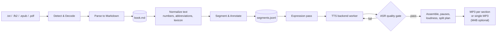

# Text2Audio — Offline Document-to-Audiobook Pipeline

**Project Specification**

| | |
|---|---|
| Document version | 1.2-M0 |
| Status | **Approved for M0** (open decisions in §13.1) |
| Last updated | 2026-10-24 |
| Primary language | Python 3.11+ |
| Usage / license | **Personal use only** — license is not a selection criterion (§13.1, ADR-0007) |

**Change log**

| Version | Date | Summary |
|---|---|---|
| 0.1 | 2026-10 | Initial draft. |
| 0.2 | 2026-10-24 | Refreshed TTS model catalog (Kokoro / Chatterbox replace XTTS-v2 / Bark as defaults); added EPUB input, segment manifest, plugin-by-entry-point and isolated backend workers, ASR quality gate, M4B output, loudness targets, hardware tiers, measurable NFRs, security section, glossary and references. |
| 0.3 | 2026-10-24 | MP3 is the default output format; M4B becomes optional. Added automatic splitting into one file per book section with sanity checks and fallback to a single file (§6.8.1). |
| 0.4 | 2026-10-24 | One folder per book under the output root, named after the input file name; work files moved to `_work/`; batch conversion (§5.2, FR-21). |
| 0.5 | 2026-10-24 | Zero-config quality: automatic decisions, per-language profiles (English, Russian, generic fallback) and content profiles supply the defaults when `text2audio.toml` is empty (§6.6.5, FR-22). |
| 0.6 | 2026-10-24 | **Decision:** Russian confirmed as the second language (M4). Added decision log (§13.1). |
| 0.7 | 2026-10-24 | Russian research: stress (RUAccent default), normalization (rutextnorm, to be audited), per-language QA ASR (GigaAM-v3 for Russian), Russian backend shortlist with license notes, offline asset checklist and M4 benchmark protocol (§6.6.5, §8). |
| 0.8 | 2026-10-24 | **Principle: no universal model.** Every language-dependent pipeline stage is pluggable per language (§6.6.1); per-language component matrix; mixed-language routing across different backends; per-language overrides in config; install only the languages you need. |
| 1.0-M0 | 2026-10-24 | Approved for M0. License default recorded as proposed (MIT core). Companion docs added: README, CLAUDE.md, CONTRIBUTING, CHANGELOG, ADRs 0001–0006, `docs/adding-a-language.md`. |
| 1.1-M0 | 2026-10-24 | **Decision:** personal use only. Component priority is offline → quality → everything else; licenses are informational. Non-commercial models (IndexTTS-2, XTTS-v2, ESpeech, Silero v5, MMS) become full candidates; PDF reader chosen by M1 benchmark; licensing risk removed. |
| 1.2-M0 | 2026-10-24 | **Decision:** Russian is the **first** language (M2), English second (M4) — ADR-0008. Russian benchmark protocol moves to M2; isolation proof (FR-07) moves to English. QA gate (§6.9) made per-language; pack paths aligned with §10. |

The key words **MUST**, **SHOULD** and **MAY** are used as described in
[RFC 2119](https://www.rfc-editor.org/rfc/rfc2119).

---

## 1. Executive Summary

Text2Audio is an **offline, multi-language document-to-audiobook pipeline**. It
converts documents — **plain text (`.txt`), FictionBook (`.fb2`, `.fb2.zip`), EPUB
(`.epub`) and PDF (`.pdf`)** — into clean, human-editable **Markdown**, and then
synthesizes that Markdown into an **audiobook (MP3 by default, one file per book
section where the structure allows it)** using local neural
text-to-speech (TTS) models.

Design pillars:

1. **Offline by contract** — after installation, no network access is needed or
   attempted. Air-gapped installation is supported through an exportable bundle.
2. **Best-of-breed per language** — there is no single model that is best for every
   language, so each language chooses its own TTS model **and** its own text
   processing, stress/G2P, quality-check ASR and emotion components. Each language and
   each model ships as an independent, installable package that can live in its own
   repository and its own Python environment.
3. **Expressive, not monotone** — a layered expression system goes from cheap
   structural prosody (pauses, voice changes for dialogue) up to emotion-aware
   synthesis on backends that support it.
4. **Verifiable quality** — every synthesized segment is checked automatically
   (speech recognition round-trip) and re-generated if the model skipped, repeated or
   invented words.

---

## 2. Problem Statement

- E-books and documents exist in many formats (FB2, EPUB, PDF, TXT) that are not
  directly consumable as audio.
- High-quality TTS is mostly cloud-based: it requires a network connection, has
  per-character costs, and sends document content to third parties.
- Users want a **private, reproducible, offline** way to turn documents into
  audiobooks in **their own language**.
- Naive TTS reads text monotonically and mispronounces numbers, abbreviations and
  names; a good audiobook needs **text normalization, pacing, voice variety and
  emotional expression**.
- Modern autoregressive TTS models occasionally **hallucinate** (skip, repeat or invent
  words); at book length this is guaranteed to happen and must be detected.

---

## 3. Goals and Non-Goals

### 3.1 Goals

1. Convert `.txt`, `.fb2`, `.epub` and `.pdf` into normalized Markdown.
2. Synthesize high-quality speech from Markdown, **entirely offline**.
3. Support **multiple languages**: **Russian first** (M2), English second (M4).
4. Allow new languages and models to be added as **independent packages** without
   modifying the core, with **a different model family and toolchain per language**
   where that gives better results.
5. Provide **layered expression** support (structural → inferred → manual).
6. Produce audiobook output as **MP3 by default**, split into **one file per book
   section** when the structure is reliable, otherwise a single file; **M4B**, Opus and
   WAV are optional.
7. One-command bootstrap that installs dependencies and downloads all weights, leaving
   the project fully offline-capable.
8. **Best possible result with zero configuration**: with an empty `text2audio.toml`,
   the language profile, content detection and installed hardware decide every
   setting; configuration only overrides.

### 3.2 Non-Goals (v1)

- Cloud or streaming TTS, or any runtime network dependency.
- Real-time / low-latency synthesis (batch processing is sufficient).
- DRM-protected or encrypted documents.
- OCR of scanned PDFs (deferred to v2 — see §11).
- GUI (CLI + Python API only in v1).
- Music, sound effects, or full audiobook mastering/mixing.
- Training or fine-tuning TTS models (only inference on published weights).
- Commercial use or redistribution of generated audio or bundled models (personal use
  only — see ADR-0007).

---

## 4. Users and Use Cases

| Persona | Need | Key requirements |
|---|---|---|
| **Reader / listener** | Turn a personal e-book library into audiobooks, privately. | FR-01..FR-06, NFR-01 |
| **Editor / producer** | Fix pronunciation, assign voices, tune emotion, re-render only changed parts. | FR-08, FR-10, FR-13, FR-14 |
| **Language contributor** | Add a new language or model without learning the core codebase. | FR-07, §6.6 |
| **Operator (air-gapped site)** | Install on a machine that never touches the internet. | FR-04, FR-16, §6.10 |

---

## 5. System Overview

### 5.1 Pipeline



| Stage | Responsibility | Artifact |
|---|---|---|
| **Detect & Decode** | Detect format by content (magic bytes / XML root / zip contents), detect encoding, unpack archives safely. | — |
| **Parse to Markdown** | Extract structure (chapters, headings, paragraphs, emphasis, quotes, poetry, footnotes) and metadata (title, author, language, cover). | `book.md` + `metadata.json` + `cover.jpg` |
| **Normalize text** | Language-specific verbalization of numbers, dates, units, abbreviations; apply pronunciation lexicon. | (in-memory) |
| **Segment & Annotate** | Split into synthesis units that fit the backend's input limit; attach voice, language, pause and expression attributes. | `segments.jsonl` |
| **Expression pass** | Map structural / inferred / manual expression to the backend's control vocabulary. | updates `segments.jsonl` |
| **TTS backend worker** | Synthesize each segment in an isolated process. | `audio/segments/*.wav` |
| **ASR quality gate** | Transcribe each segment, compare to source, retry failures. | `report.json` |
| **Assemble** | Insert pauses, concatenate, normalize loudness, decide the split plan (§6.8.1), encode, write tags. | `<output root>/<book>/*.mp3` (+ optional `.m4b`) |

### 5.2 Output layout (one folder per book)

All results go under an **output root** (default `./output`, set with `-o` or
`output.root`). Each input file gets **its own book folder, named after the input
file name**. The finished audio sits at the top of the book folder, ready to copy to a
player; everything needed to edit and resume lives in `_work/`.

```text
output/                                  # output root
├── War and Peace/                       # from "War and Peace.fb2.zip"
│   ├── 01 - Book One, Chapter 1.mp3     # one MP3 per section (split mode)…
│   ├── 02 - Book One, Chapter 2.mp3
│   ├── …
│   ├── War and Peace.m3u                # playlist in reading order
│   ├── War and Peace.m4b                # optional, only if enabled
│   ├── report.json                      # QA results, timings, split decision, warnings
│   └── _work/                           # resumable workspace
│       ├── text2audio.toml              # per-book settings (voices, expression, output)
│       ├── source.fb2.zip               # copy of (or link to) the original input
│       ├── book.md                      # editable Markdown (human-facing)
│       ├── metadata.json                # title, author, language, cover, source hash
│       ├── cover.jpg
│       ├── lexicon.tsv                  # per-book pronunciation overrides
│       ├── segments.jsonl               # segment manifest (§6.4.2)
│       └── audio/
│           ├── segments/                # one file per segment, named by content hash
│           └── chapters/                # assembled per-section WAV (intermediate)
├── moby-dick/                           # from "moby-dick.epub"
│   └── …
└── report (pdf)/                        # from "report.pdf" when "report.txt" also exists
    └── …
```

**Folder naming rules**

1. **Name = input file name without its format extension(s)**: `War and Peace.fb2.zip`
   → `War and Peace`, `notes.txt` → `notes`. Known compound extensions
   (`.fb2.zip`) are stripped as one.
2. **Sanitized, not transliterated**: Unicode (e.g. Cyrillic) names are kept;
   characters invalid on common filesystems (`/ \ : * ? " < > |`, control characters)
   become `_`; leading/trailing dots and spaces are trimmed; length is capped at 120
   bytes. `--name <folder>` overrides the derived name.
3. **Same source again → same folder.** If the folder exists and
   `_work/metadata.json` has the same source hash, the run **resumes** in it (FR-10).
4. **Name clash with a different source:**
   - same name, different format (`report.txt` and `report.pdf` in one batch) →
     the format is appended: `report (pdf)`;
   - same name and format, different content → a counter is appended:
     `notes (2)`, unless `--overwrite` is given.
5. **Batch input**: several files or a directory (`text2audio run books/`) produce one
   book folder per supported file; one failing book does not stop the others, and a
   summary lists each book's folder and status.

Final file names inside the book folder follow §6.8 (`NN - <Section title>.mp3`,
`<book folder name>.m3u`, `<book folder name>.m4b`).

---

## 6. Specification

### 6.1 Functional Requirements

| ID | Requirement | Priority | Acceptance criteria |
|---|---|---|---|
| FR-01 | Accept `.txt`, `.fb2`, `.fb2.zip`, `.epub`, `.pdf` and detect the format by content, not only by extension. | Must | A renamed file (e.g. `.fb2` saved as `.txt`) is detected correctly in tests. |
| FR-02 | Convert each format to normalized Markdown (§6.4.1), preserving chapters, headings, paragraphs, emphasis, block quotes, epigraphs, poetry and footnotes. | Must | Golden-file tests pass for every format; chapter count matches the source TOC. |
| FR-03 | Extract metadata: title, author(s), language, series, cover image. | Must | Metadata from FB2 `<title-info>` and EPUB OPF appears in `metadata.json` and in output tags. |
| FR-04 | Run **100% offline** after installation. | Must | Full test suite passes inside a network namespace with no interfaces (§12). |
| FR-05 | Provide a CLI (§6.11) and an importable Python API with the same capabilities. | Must | Every CLI command has an equivalent public API function covered by tests. |
| FR-06 | Support **Russian** (M2) and **English** (M4) end-to-end in v1, on both hardware tiers (§9). | Must | A Russian and an English audiobook are produced from each input format on T0 and T1 hardware. |
| FR-07 | Discover languages, TTS backends and per-stage components (normalizer, G2P/stress, ASR, emotion) as **plugins via Python entry points** (§6.6.1); each language may use a different implementation for every stage; adding one requires no core change. | Must | English is added in M4 (after Russian) with zero diff under `src/text2audio/core/`. |
| FR-08 | Persist `book.md` and `segments.jsonl` so users can inspect and edit before synthesis; re-running picks up edits. | Must | Editing one paragraph re-synthesizes only the affected segments. |
| FR-09 | Output **MP3** by default (ID3v2 tags, embedded cover). **M4B** (AAC, chapter markers, cover), **Opus** and **WAV** are optional and can be produced alongside MP3. | Must | Default run produces MP3 only; `--format m4b` adds an M4B whose chapter list `ffprobe` shows; output plays in at least two common players. |
| FR-10 | **Resume / incremental rendering**: segments are cached by content hash; interrupted jobs continue where they stopped. | Must | Killing a job mid-chapter and restarting loses at most one segment of work. |
| FR-11 | **Text normalization** per language (numbers, ordinals, dates, currency, units, common abbreviations, Roman numerals in headings). | Must | Language-pack normalization test set passes (≥ 95% exact match). |
| FR-12 | **ASR quality gate**: transcribe each segment, compute word error rate (WER) against the normalized text, retry failing segments, report the rest. | Must | Injected faulty segments in tests are detected and retried. |
| FR-13 | **Pronunciation lexicon** at three levels — language pack, user-global, per-book — later levels override earlier ones. | Should | A per-book entry changes the pronunciation of a name in the output. |
| FR-14 | **Layered expression** (§6.7): E0 neutral, E1 structural (default), E2 inferred emotion, E3 manual directives. | Should | E1 works on every backend; E2/E3 work on every backend that declares emotion support. |
| FR-15 | **Multi-voice**: separate voices for narrator, dialogue, quotes/epigraphs; voices are configurable per book. | Should | A test book with dialogue renders dialogue in the configured dialogue voice. |
| FR-16 | **Offline bundle**: export all installed models and wheels to an archive and import it on an air-gapped machine. | Should | Import on a machine with networking disabled followed by `doctor` passes. |
| FR-17 | Progress reporting (TTY progress bar), structured JSON logs, and a final `report.json`. | Should | `report.json` lists per-chapter durations, real-time factor, QA failures. |
| FR-18 | Per-paragraph **language detection** for mixed-language books, routing each segment to **its own language's pipeline and backend** (which may be a different model from the main language), with a per-language narrator voice chosen to sound close to the main narrator. | May | A test book with embedded foreign quotes routes them correctly or warns. |
| FR-19 | **Voice cloning** from a reference clip on backends that support it, subject to the consent policy (§6.12). | May | Clone works on Chatterbox; refusal message shown when consent flag is absent. |
| FR-20 | **Automatic splitting** into one file per book section when the detected structure passes the sanity checks in §6.8.1; otherwise fall back to a **single file**. Mode is `auto` (default), `section` (force) or `none` (always one file). | Must | Fixture with clean chapters → one MP3 per chapter; fixture with 500 tiny sections or no headings → single MP3; the decision and reason are recorded in `report.json`. |
| FR-21 | **One output folder per book**, named after the input file name, under a configurable output root; work files in `_work/`; batch input of several files or a directory (§5.2). | Must | `run a.fb2 b.epub` creates `output/a/` and `output/b/`; re-running `a.fb2` resumes in `output/a/`; a name clash produces `a (pdf)` or `a (2)` as specified. |
| FR-22 | **Zero-config quality**: every setting has an automatic value derived from the language profile, content profile and hardware (§6.6.5); `text2audio config show <book>` prints the effective value and the source of each setting. | Must | With an empty `text2audio.toml`, fixtures in each supported language select the expected backend, voices, pauses, normalization and footnote policy; output passes the QA gate. |

### 6.2 Non-Functional Requirements

| ID | Requirement | Measure |
|---|---|---|
| NFR-01 | **Offline**: no network calls at runtime; all assets (weights, G2P dictionaries, tokenizers, NLP data) resolve from the local model store. | Zero outbound connections in network-blocked CI. |
| NFR-02 | **Isolation**: a language pack or backend is a self-contained package with its own dependencies; one backend's dependency pins cannot break another. | Two backends with conflicting `torch` pins are installed and used in the same job. |
| NFR-03 | **Determinism**: on CPU, same input + seed + model revision ⇒ byte-identical segment audio. On GPU, output is reproducible within tolerance (same transcript, duration within ±2%). | Determinism test (§12). |
| NFR-04 | **Reproducibility**: Python deps locked (`uv.lock`); every model file pinned by Hugging Face commit revision and SHA-256 in `models.lock`. | Install from lockfiles yields identical hashes. |
| NFR-05 | **Performance**: real-time factor (RTF = synthesis time ÷ audio duration) of ≤ 0.5 on T0 with the fast tier, ≤ 0.5 on T1 with the expressive tier. | Benchmark job on reference hardware (§9); numbers validated in M2. |
| NFR-06 | **Memory**: documents are processed chapter-by-chapter; peak RAM of the core (excluding the model) stays under 500 MB for a 1,000-page book. | Memory benchmark in CI. |
| NFR-07 | **Hardware**: must degrade gracefully to CPU-only; GPU (CUDA) used when present; Apple Silicon (MPS) best-effort. | `doctor` reports selected device and tier. |
| NFR-08 | **Portability**: Linux x86_64 / arm64 (primary), macOS arm64 (secondary), Windows (best-effort, via WSL2 recommended). | CI matrix covers Linux + macOS. |
| NFR-09 | **Robustness**: one failing segment never aborts a book; failures are retried, then reported. | Fault-injection tests. |
| NFR-10 | **Security**: untrusted inputs are parsed safely; only safe weight formats are loaded (§6.12). | Security tests with malicious fixtures. |
| NFR-11 | **Observability**: structured logs with job/chapter/segment IDs; no document text in logs at INFO level. | Log-format test. |

### 6.3 Input Format Rules

| Format | Parser approach | Notes |
|---|---|---|
| `.txt` | Encoding detection with [charset-normalizer](https://github.com/jawah/charset_normalizer); heuristic structure inference (chapter-heading regexes per language, blank-line paragraphs, `*` / `—` dialogue). | Heuristics live in the language pack (e.g. "Chapter 1", "Глава 1"). |
| `.fb2` / `.fb2.zip` | XML parse with [defusedxml](https://github.com/tiran/defusedxml) + [lxml](https://lxml.de/) following the [FictionBook 2](https://en.wikipedia.org/wiki/FictionBook) schema. Honour the XML declaration's encoding (often `windows-1251`). | Map `<section>` → chapter hierarchy, `<title>` → heading, `<p>`, `<emphasis>`, `<strong>`, `<epigraph>`, `<cite>`, `<poem>/<stanza>/<v>`, `<subtitle>`, `<empty-line/>`. Footnotes live in `<body name="notes">` and are linked by `l:href`. Cover from `<coverpage>` + `<binary>`. Language from `<title-info><lang>`. |
| `.epub` | Treat as ZIP + [EPUB 3](https://www.w3.org/TR/epub-33/) package: read OPF manifest/spine and nav/NCX TOC, convert XHTML to Markdown with a custom lxml walker (EPUB 2 also supported). | A custom reader gives full control over structure mapping; [EbookLib](https://github.com/aerkalov/ebooklib) may be used for package parsing if it handles the fixture corpus better. Language from `dc:language`. |
| `.pdf` | Layout-aware extraction. Candidates: [Docling](https://github.com/docling-project/docling), [pymupdf4llm](https://github.com/pymupdf/pymupdf4llm) (fast, CPU-only), [Marker](https://github.com/datalab-to/marker) (strong on complex layouts, GPU). **Default chosen by the M1 benchmark** on the PDF fixture set; the others stay available as reader plugins. | Drop running headers/footers and page numbers; re-join hyphenated line breaks; tables read as "row: cell, cell" or skipped (configurable). Text-layer PDFs only in v1. |

Footnote policy (configurable): `inline` (read in place, in a different voice),
`chapter-end` (default), or `skip`.

### 6.4 Intermediate Formats

#### 6.4.1 Markdown dialect

- [CommonMark](https://spec.commonmark.org/) parsed with
  [markdown-it-py](https://github.com/executablebooks/markdown-it-py).
- `#` = book title, `##` = chapter (chapter boundary for audio), `###`+ = sections.
- Block quotes = quotes / epigraphs; poetry kept as line-broken blocks.
- Footnotes use the `[^1]` extension.
- **Directives** for manual control use HTML comments, so the file still renders
  cleanly in any Markdown viewer:

```markdown
## Chapter 3

<!-- t2a: voice=narrator emotion=calm -->
The house was silent.

<!-- t2a: voice=anna emotion=fearful intensity=0.7 -->
"Is anyone there?" she whispered.

<!-- t2a: pause=2000 -->
```

#### 6.4.2 Segment manifest (`segments.jsonl`)

One JSON object per line; this is the machine-facing source of truth for synthesis and
caching. It is regenerated from `book.md`; manual edits belong in `book.md`.

```json
{"id": "ch03-s0012", "chapter": 3, "text": "Is anyone there? she whispered.",
 "text_norm": "Is anyone there? she whispered.", "lang": "en", "voice": "anna",
 "role": "dialogue", "emotion": "fearful", "intensity": 0.7,
 "pause_after_ms": 300, "backend": "chatterbox", "seed": 1234,
 "hash": "sha256:9f2c…", "status": "done", "wer": 0.0, "attempts": 1}
```

`hash` covers normalized text + voice + expression + backend + model revision + seed,
so any change invalidates exactly the affected segments.

### 6.5 Text Processing

- **Normalization** — per language, provided by the language pack. Candidates:
  [NeMo text-processing](https://github.com/NVIDIA/NeMo-text-processing) (Apache-2.0,
  grammar-based, many languages; heavy `pynini` dependency) or lighter
  [num2words](https://github.com/savoirfairelinux/num2words) (LGPL) + rules.
- **Sentence segmentation** — [pySBD](https://github.com/nipunsadvilkar/pySBD) (rule
  based, many languages, no model download) by default.
- **Chunking** — segments are packed up to the backend's declared `max_chars`
  (typically ~200–400 characters, roughly 15–25 s of speech); never split mid-sentence
  unless a sentence exceeds the limit, in which case split at clause punctuation.
- **Language detection** — [lingua-py](https://github.com/pemistahl/lingua-py)
  (Apache-2.0, offline, accurate on short text) for FR-18; document-level language
  comes from metadata first.
- **Lexicon** — TSV `word<TAB>replacement-or-phonemes`, applied after normalization.

### 6.6 Multi-Language and Plugin Architecture

#### 6.6.1 Principles

**There is no silver bullet.** Open TTS quality varies sharply by language: a model
that leads in English can be mediocre in Russian, and the hard problems differ too
(heteronyms in English, unwritten stress and case agreement in Russian, tones in
Chinese, vowel diacritics in Arabic or Hebrew). The architecture therefore treats
**every language-dependent stage as replaceable per language**, and never assumes one
model, one G2P or one ASR for all languages. Multilingual models are welcome, but only
as one option a language may choose, not as the design centre.

- The core is **language-agnostic**: it handles documents, Markdown, segments, caching,
  QA orchestration and audio assembly.
- **Language packs** choose and configure the components for their language (table
  below) and supply text rules, lexicon and default voices.
- **Backends** provide synthesis for one model family and declare capabilities.
- **Components** (normalizer, stress/G2P, ASR, emotion classifier) are plugins too, so
  a language can use a third-party or its own implementation.
- All of these are discovered through
  [Python entry points](https://packaging.python.org/en/latest/specifications/entry-points/),
  so each can be a separate distribution in a separate repository
  (`text2audio-lang-de`, `text2audio-backend-chatterbox`, …), with its own release
  cycle and its own isolated environment (§6.6.3).

**Per-language plug points**

| Stage | Entry-point group | Why it differs by language | English (M4) | Russian (M2, first) |
|---|---|---|---|---|
| Sentence segmentation | `text2audio.segmenters` | Abbreviation and punctuation conventions | pySBD `en` | pySBD `ru` + pack rules |
| Text normalization | `text2audio.normalizers` | Number grammar, date/currency formats | NeMo TN or pack rules | rutextnorm (after audit) + pack rules |
| Stress / G2P | `text2audio.g2p` | Unwritten stress, heteronyms, diacritics | misaki + espeak-ng | RUAccent (silero-stress fallback) |
| TTS backend (per tier) | `text2audio.backends` | Model quality and voice availability per language | Kokoro / Chatterbox | Piper or Silero v5 / Chatterbox Multilingual or Qwen3-TTS (M2 benchmark) |
| QA ASR | `text2audio.asr` | ASR accuracy per language | faster-whisper | GigaAM-v3 |
| Emotion classifier (E2) | `text2audio.emotion` | Trained per language | TBD (M3) | TBD |
| Content heuristics | part of the language pack | Chapter/dialogue/drama conventions | "Chapter", quotes | "Глава", dialogue dash |

A language pack's profile names its components per stage; any stage it leaves out falls
back to the core's generic implementation (§6.6.5, "Generic fallback").

**Rules that keep this workable**

1. **One interface per stage, many implementations.** The core only talks to the stage
   interface; it never imports a specific model.
2. **Choice is data, not code.** The profile ranks candidates per stage and tier; the
   first *installed* candidate wins, so users can install a cheaper or better
   alternative without code changes.
3. **Users can override per language** in config:

   ```toml
   [lang.ru]
   backend.expressive = "qwen3-tts"
   g2p                = "silero-stress"

   [lang.en]
   backend.fast = "piper"
   ```

4. **Install only what you use.** `text2audio models pull --lang ru --tier fast`
   downloads only the Russian fast-tier components; adding a language later never
   requires reinstalling others.
5. **Swapping a component is benchmarked, not guessed.** Each pack keeps its benchmark
   set (see the Russian M2 protocol) so a new model can be compared with the current
   default using the same metrics before the default changes.
6. **Review the catalog every release** (§8): the best choice per language is expected to
   change over time.

```toml
# pyproject.toml of a language pack
[project.entry-points."text2audio.languages"]
de = "text2audio_lang_de:LanguagePack"

# pyproject.toml of a backend
[project.entry-points."text2audio.backends"]
chatterbox = "text2audio_backend_chatterbox:Backend"
```

#### 6.6.2 Backend contract

```python
class Backend(Protocol):
    name: str
    capabilities: Capabilities   # languages, voices, emotion mode, cloning,
                                 # max_chars, sample_rate, device support
    def assets(self) -> list[ModelAsset]: ...      # everything to download (repo, revision, files, sha256)
    def load(self, store: ModelStore, device: str) -> None: ...
    def synthesize(self, seg: Segment, out_path: Path) -> SynthesisResult: ...
```

`Capabilities.emotion` is one of `none | scalar | tags | prompt | vector`, which tells
the expression layer how to translate an emotion (§6.7).

#### 6.6.3 Isolated backend workers

TTS models pin conflicting versions of `torch`, `transformers` and friends, so one
shared environment for all of them doesn't scale. Each backend therefore runs in **its
own [uv](https://docs.astral.sh/uv/)-managed virtual environment** as a long-lived
**worker process**, and talks to the core over a newline-delimited JSON protocol on
stdin/stdout:

```text
core → worker   {"op": "load", "device": "cuda:0"}
worker → core   {"ok": true, "sample_rate": 24000}
core → worker   {"op": "synthesize", "segment": {...}, "out": "audio/segments/9f2c.wav"}
worker → core   {"ok": true, "duration_ms": 4120, "elapsed_ms": 1630}
```

Backends whose dependencies are compatible with the core MAY run in-process (e.g.
ONNX-based Kokoro or Piper) for lower overhead. The protocol is versioned
(`"protocol": 1`).

#### 6.6.4 Language pack manifest

```toml
# plugins/lang-en/text2audio-lang.toml
[language]
code = "en"
name = "English"
default_backend = { fast = "kokoro", expressive = "chatterbox" }

[voices]
narrator  = { kokoro = "af_heart", chatterbox = "voices/narrator.wav" }
dialogue  = { kokoro = "am_michael", chatterbox = "voices/dialogue.wav" }

[normalization]
engine = "nemo"            # or "rules"

[profile]                  # language defaults used when the book config is silent (§6.6.5)
backends      = { fast = ["kokoro", "piper"], expressive = ["chatterbox", "orpheus"] }
speaking_rate = 1.0
pauses_ms     = { sentence = 300, paragraph = 700, section = 1500, chapter = 3000 }
quotes        = ["“”", "\"\""]          # dialogue delimiters
dialogue_dash = false                   # true for languages that open dialogue with "—"
qa            = { asr_model = "faster-whisper:large-v3-turbo", asr_language = "en", wer_threshold = 0.12, chars_per_sec = [10, 22] }
```

A `_template` cookiecutter generates a new language pack with tests and CI.

#### 6.6.5 Zero-Config Defaults and Language Profiles

**Principle:** a user who runs `text2audio run book.fb2` with no configuration must get
the best audio that the installed language pack, backends and hardware allow.
`text2audio.toml` is for overrides only. Defaults come from three layers:

```text
core defaults → language profile → content profile → user config → book _work/text2audio.toml → CLI flags
                (from the pack)    (detected per book)                                       (later wins)
```

The generated `_work/text2audio.toml` lists every effective value **as comments**, with
its source (`# from profile:ru`), so users can see exactly what to change.
`text2audio config show <book>` prints the same view.

##### Automatic decisions

| Setting | Automatic rule when not configured |
|---|---|
| Language | Document metadata (FB2 `<lang>`, EPUB `dc:language`) → detection on the first ~20 kB of text (lingua-py) → `en` with a warning. |
| Tier | `expressive` if a supported GPU with enough VRAM is present (§9), otherwise `fast`. |
| Backend | First **installed** backend in the language profile's ranked list for that tier; otherwise any installed multilingual backend that declares the language; otherwise a clear error naming the pack/backend to install. |
| Voices | The profile's narrator voice plus a **contrasting** dialogue voice (different pitch/gender), both pre-tested by the pack. |
| Expression | E1. E2 only when the profile ships a validated emotion classifier and the tier is `expressive`. |
| Normalization, lexicon, stress | From the language profile (below). |
| Pauses, speaking rate | From the language profile, then adjusted by the content profile. |
| Footnotes | `chapter-end` for FB2/EPUB (real notes); `skip` for PDF (often page artefacts). |
| Front/back matter | Table of contents, copyright/ISBN pages, indexes and "Other books by…" pages are **skipped**; title, author and dedication are read. |
| QA | On; ASR model by tier; WER threshold and speaking-rate bounds from the language profile. |
| Output | MP3, `split = "auto"`, default loudness. |
| Seed | Fixed (`1234`) so re-runs are reproducible. |

##### What a language profile provides

| Area | Contents |
|---|---|
| **Text structure** | Chapter-heading patterns for TXT/PDF ("Chapter 1", "Глава 1", "Kapitel 1", Roman numerals); front-matter markers ("Contents", "Содержание"). |
| **Normalization** | Numbers (cardinal/ordinal, with grammatical agreement where the language needs it), dates, times, currency, units, percentages, Roman numerals in context, abbreviations, initials, symbols (`§`, `№`, `%`, `&`), URLs/e-mails policy. |
| **Pronunciation** | G2P engine, stress and homograph handling, base lexicon of names and loanwords common in that language's literature. |
| **Typography & dialogue** | Quote characters, dialogue-dash convention, patterns for splitting **author's remarks** out of dialogue so they are read in the narrator voice. |
| **Prosody** | Speaking rate and pause lengths tuned for the language; handling of `…`, `?!`, em-dash pauses. |
| **Voices & backends** | Ranked backends per tier; tested narrator/dialogue voice pairs per backend. |
| **QA bounds** | ASR model and language, WER threshold (morphologically rich languages tolerate a higher WER), characters-per-second range. |
| **Test corpus** | Normalization test set and golden paragraphs used in CI and in FR-11. |

##### Built-in profiles

**English (`en`, second language, M4 — Must)**
- G2P with [misaki](https://github.com/hexgrad/misaki) (Apache-2.0, used by Kokoro)
  and [espeak-ng](https://github.com/espeak-ng/espeak-ng) fallback; heteronyms
  (*read*, *lead*, *live*) resolved by part of speech.
- Abbreviations: *Mr., Mrs., Dr., St.* (Saint vs. Street by context), *etc., e.g., i.e.*
  (expanded to "for example", "that is"), *vs.*, *No.*
- Numbers: years as years (*1984* → "nineteen eighty-four"), times (*3:45*), currency
  (*$5.20*), ordinals (*21st*), Roman numerals after names and in headings
  (*Henry VIII*, *Chapter IV*) but not the pronoun *I*.
- Dialogue: straight and curly double quotes; attribution after a closing quote
  ("…," she said) goes to the narrator voice.

**Russian (`ru`, first language, M2 — Must; FB2 is primarily a Russian-language
format; ADR-0008)**

Russian TTS has problems English barely has: **lexical stress is not written**,
**ё is usually printed as е**, and **numbers must agree in case and gender** with
the surrounding words. These are solved in the language pack, before synthesis, so any
backend benefits. Component choices below come from public sources (§16) and are
validated by the M2 benchmark. All of them run locally; they are downloaded only at
install time.

| Area | Default | Alternative / fallback | Notes |
|---|---|---|---|
| **Stress + ё** | [RUAccent](https://github.com/Den4ikAI/ruaccent) (MIT) | [silero-stress](https://github.com/snakers4/silero-stress) (MIT) — smaller and faster | RUAccent resolves context-dependent homographs (*зáмок/замóк*) and ambiguous *все/всё* from context; its [COLING 2025 paper](https://aclanthology.org/2025.coling-main.444/) self-reports 0.96 accuracy on homographs and 0.97 on other words. silero-stress leaves ambiguous ё-homographs untouched. Stress marks already in the source (`´`, `+`) are always respected. |
| **Normalization** | [rutextnorm](https://libraries.io/pypi/rutextnorm) (MIT, rule-based, no dependencies) — **after a code audit** | Rules in the pack + [num2words](https://github.com/savoirfairelinux/num2words) `ru` | Covers numbers, dates, currency, units, fractions **with case agreement** (*с 5 книгами* → "с пятью книгами", *с 2010 года* → "с две тысячи десятого года"). Its `flag_uncertain()` returns spans the rules cannot resolve; these are logged in `report.json` and can be fixed via the per-book lexicon. Its upstream ([shigabeev/russian_tts_normalization](https://github.com/shigabeev/russian_tts_normalization)) is a small project whose README says it was written with ChatGPT's help, so it is pinned, audited and covered by the pack's own normalization test set; if it fails the audit the pack owns its rules instead. |
| **Stress-aware G2P** | Backend's own front end fed with stress-marked text | espeak-ng `ru` | Stress is passed in the format each backend understands (`+` before the vowel, or U+0301 combining acute); the backend adapter converts. |
| **QA ASR** | [GigaAM-v3](https://huggingface.co/ai-sage/GigaAM-v3) (MIT) | faster-whisper `large-v3-turbo` | Vendor and third-party reports favour GigaAM over Whisper on Russian; confirmed by measurement in M2. QA ASR is therefore **per language** (`qa.asr_model` in the profile). |

Text rules:

- Numbers: cardinal/ordinal with case and gender; centuries and monarchs in Roman
  numerals (*XIX век* → "девятнадцатый век", *Пётр I* → "Пётр Первый");
  years (*в 1812 году*), dates (*12.06.2025*), time (*в 15:30*), currency (*500 ₽*,
  *$20*), percentages, ranges (*5–7 лет*).
- Abbreviations: *т. е., т. д., т. п., и др., и пр., г.* (год/город by context),
  *гг., в., вв., руб., коп., тыс., млн, млрд, ул., д., им., см.*; initials
  (*А. С. Пушкин*) read as letters or skipped, per setting.
- Dialogue: paragraphs opening with `—` are dialogue, and author's remarks after an
  inner dash (*— Привет, — сказал он.*) are split into the narrator voice; quotes
  `«…»` and `„…“`.
- Prosody: slightly longer default paragraph pause (800 ms); `—` inside a sentence gets
  a short pause; `…` a longer one.
- QA bounds: higher WER threshold than English (rich morphology makes ASR endings
  noisier) — starting value 0.18, tuned in M2.

**Backend shortlist for Russian** (details in §8):

| Tier | Candidates | Key caveats |
|---|---|---|
| fast (CPU) | [Piper](https://github.com/OHF-Voice/piper1-gpl) `ru_RU` voices; [Silero TTS v5](https://github.com/snakers4/silero-models) | Kokoro has **no official Russian**; community Kokoro-ru fine-tunes are experimental. Silero v5 is fast with many Russian voices; it loads through `torch.hub`, so its files must be pre-fetched (see below). |
| expressive (GPU) | [Chatterbox Multilingual](https://github.com/resemble-ai/chatterbox) (MIT, Russian officially supported); [Qwen3-TTS](https://github.com/QwenLM/Qwen3-TTS) (Russian listed) | Chatterbox Multilingual has no paralinguistic tags (`<laugh>` etc.), so E2 uses the `exaggeration` scalar only. |
| expressive (GPU), additional | [ESpeech-TTS](https://huggingface.co/ESpeech/ESpeech-TTS-1_SFT-256K) (F5-TTS fine-tune trained on Russian); [XTTS-v2](https://github.com/idiap/coqui-ai-TTS) (Russian supported, voice cloning) | Russian-specific training may beat multilingual models on naturalness; XTTS-v2 is older but well proven for Russian. Both enter the M2 benchmark on equal terms. |

**Offline asset checklist (Russian).** Several Russian components download weights
on first use (RUAccent from Hugging Face, Silero via `torch.hub`, GigaAM on first
load). The `ru` pack MUST list every one of them in `models.lock` and load them from
the model store explicitly. The offline CI job (§12) runs the full Russian fixture set
with networking disabled to prove nothing is fetched at runtime.

**M2 benchmark protocol (decides the Russian defaults).**

1. Test set (public-domain Russian prose and poetry, e.g. Pushkin, Chekhov, Tolstoy):
   ≥ 200 sentences including ≥ 50 stress homographs, ≥ 50 ё-words, ≥ 50 numbers needing
   case agreement, dialogue with author's remarks, and one poem.
2. Metrics per backend: QA-ASR WER (GigaAM), **stress accuracy** on the homograph
   subset (human-checked), normalization exact match, RTF on T0 and T1, VRAM.
3. Blind listening test with native speakers (≥ 5 listeners, ≥ 30 clips). UTMOS-type
   predictors are trained mostly on English and are reported for reference only.
4. The winners per tier become the profile defaults and are recorded in the decision
   log (§13.1).

**Generic fallback (any other language)**
- Used when the language is detected but no pack is installed and a multilingual
  backend supports it: sentence splitting with pySBD, numbers via num2words when it
  supports the language, no lexicon or stress handling.
- The CLI and `report.json` warn that quality is reduced and name the pack to
  install, if one exists.

##### Content profiles (detected per book, language-independent)

| Detected content | Signal | Adjustment |
|---|---|---|
| **Poetry** | FB2 `<poem>`, EPUB verse markup, many short lines of similar length | Keep line breaks; rate −10%; line pause 400 ms, stanza pause 900 ms. |
| **Dialogue-heavy fiction** | High share of dialogue paragraphs | Dialogue voice on; author's-remark splitting on. |
| **Non-fiction / technical** | Many numbers, tables, URLs, code blocks | Tables read as "row: cell, cell" or skipped; URLs read as "link to example.com"; code blocks skipped with a short announcement. |
| **Plays / drama** | Speaker labels (`HAMLET.`, `ГАМЛЕТ.`) | Speaker label read once per change; optional voice per character (v2). |

A language without a profile entry for a setting inherits the core default, so new
packs can start small and improve incrementally.

### 6.7 Expression Strategy

Expression is layered. Each level builds on the previous one, and every level degrades
gracefully on backends with fewer capabilities.

| Level | Name | Source of expression | Works on |
|---|---|---|---|
| **E0** | Neutral | None. | All backends. |
| **E1** | Structural *(default)* | Document structure: pause lengths by boundary type; slower rate and separate voice for epigraphs/poetry/quotes; dialogue detection → dialogue voice; emphasis → backend emphasis if supported. | All backends. |
| **E2** | Inferred | A small offline emotion classifier labels each segment (e.g. `neutral, joy, sadness, anger, fear, surprise`) with an intensity; smoothed across neighbouring segments to avoid jarring jumps. | Backends with `emotion != none`. |
| **E3** | Manual | `<!-- t2a: … -->` directives in `book.md` override E1/E2. | Backends with `emotion != none` (voice/pause directives work everywhere). |

Mapping emotion to backend controls:

| Capability | Example backend | Mapping |
|---|---|---|
| `scalar` | [Chatterbox](https://github.com/resemble-ai/chatterbox) | Intensity → `exaggeration` (and `cfg_weight`); emotion → choice of reference clip per voice. |
| `tags` | [Orpheus TTS](https://github.com/canopyai/Orpheus-TTS) | Insert tags such as `<sigh>`, `<laugh>`, `<gasp>` where the classifier or directive asks for them. |
| `prompt` | [Qwen3-TTS](https://github.com/QwenLM/Qwen3-TTS), [Parler-TTS](https://github.com/huggingface/parler-tts) | Generate a style instruction ("speaking softly, frightened"). |
| `vector` | [IndexTTS-2](https://github.com/index-tts/index-tts) | Emotion → 8-dimensional emotion vector × intensity. |

**Validation (M3):** E1 vs E0 and E2 vs E1 are compared with a blind A/B preference
test (≥ 10 listeners, ≥ 30 paired clips); a level ships as default only if ≥ 60% of
listeners prefer it, and automatic MOS prediction
([UTMOSv2](https://github.com/sarulab-speech/UTMOSv2)) does not drop.

### 6.8 Audio Output

| Item | Default | Notes |
|---|---|---|
| Container / codec | **MP3** (LAME, 64 kbps CBR, mono, 44.1 kHz) | Optional: **M4B** (AAC-LC 64 kbps mono, with chapters), Opus (32–48 kbps), WAV (PCM 24-bit). The `acx` profile switches MP3 to 192 kbps CBR as ACX requires. |
| File layout | One MP3 per section, or a single MP3 | Decided by the split plan (§6.8.1). Files are named `NN - <Section title>.mp3` (zero-padded, filesystem-safe), with an `.m3u` playlist in reading order. |
| Chapters | M4B: one chapter per section of the split plan. Single-file MP3: ID3v2 `CHAP`/`CTOC` chapter frames | Written via [FFmpeg metadata](https://ffmpeg.org/ffmpeg-formats.html#Metadata-1); not all MP3 players show ID3 chapters, which is why split files are preferred. |
| Tags | Album = book title, title = section title, artist = author, narrator (= voice name), track N/total, year, cover | Taken from `metadata.json`; identical album tags keep split files grouped as one book in players. |
| Pauses | Sentence 300 ms · paragraph 700 ms · section 1500 ms · chapter 3000 ms | Configurable; silence is generated, not trimmed from model output. |
| Edge trimming | Remove leading/trailing silence and breaths from each segment | Prevents uneven gaps. |
| Loudness | Integrated −19 LUFS, true peak ≤ −3 dBTP ([EBU R128](https://tech.ebu.ch/publications/r128) measurement) | `acx` profile: RMS −23…−18 dB, peak ≤ −3 dB, noise floor ≤ −60 dB per [ACX requirements](https://www.acx.com/help/acx-audio-submission-requirements/201456300). Implemented with FFmpeg [`loudnorm`](https://ffmpeg.org/ffmpeg-filters.html#loudnorm) (two-pass) or [pyloudnorm](https://github.com/csteinmetz1/pyloudnorm). |
| Sample rate | Backend native, resampled to 44.1 kHz for final encode | |

#### 6.8.1 Output Splitting (split plan)

Splitting by section makes navigation easy in any player, but only when the detected
structure is trustworthy. A book with no headings, with a heading every paragraph
(common after PDF or TXT heuristics), or with one 6-hour "chapter" should not be
split blindly. The split plan is computed at assembly time from **actual** segment
durations and recorded in `report.json`.

**Algorithm (`split = "auto"`)**

1. **Pick a split level.** Start at chapter level (`##`). If that level has fewer than
   `min_parts` sections, try the next level down (`###`); if a level above exists
   (book parts) and chapter level has more than `max_parts`, try the level above.
   Use the first level that yields a section count in `[min_parts, max_parts]`.
2. **Merge short sections.** Any section shorter than `min_part_minutes` (e.g.
   dedication, epigraph, a one-page prologue) is merged into the **following**
   section (the last one merges into the previous). The merged file takes the title of
   the first section that has real content.
3. **Split long sections.** Any section longer than `max_part_minutes` is split at the
   next lower heading level if one exists, otherwise at the paragraph boundary
   closest to `target_part_minutes`; parts are titled `Chapter 5 (part 2 of 3)`.
4. **Sanity checks.** The plan is rejected, and the book is written as **one file**,
   if any of these hold:
   - no usable headings were found, or fewer than `min_parts` parts remain after
     merging;
   - more than `max_parts` parts remain;
   - more than `max_merge_ratio` (default 50%) of the original sections had to be
     merged — a sign of spurious headings;
   - heading detection confidence from the reader is low (TXT/PDF heuristics report
     a confidence score; FB2/EPUB structure is trusted).
5. **Record the decision** — chosen level, number of files, merges/splits performed, or
   the reason for falling back to a single file — in `report.json` and in the CLI
   summary.

`split = "section"` applies steps 1–3 and skips the fallback in step 4;
`split = "none"` always writes one file. A single file still carries ID3 chapter
frames for players that support them.

| Setting | Default | Meaning |
|---|---|---|
| `split` | `auto` | `auto` / `section` / `none` |
| `min_parts` | 2 | Fewer parts than this → single file. |
| `max_parts` | 150 | More parts than this → try a higher level, else single file. |
| `min_part_minutes` | 3 | Shorter sections are merged with a neighbour. |
| `max_part_minutes` | 90 | Longer sections are split. |
| `target_part_minutes` | 45 | Preferred length when splitting a long section at paragraph boundaries. |
| `max_merge_ratio` | 0.5 | Above this share of merged sections, the structure is considered unreliable. |

### 6.9 Quality Assurance Gate

Each synthesized segment goes through:

1. **ASR round-trip** — transcribe with the language profile's QA ASR
   (`qa.asr_model`: [GigaAM-v3](https://huggingface.co/ai-sage/GigaAM-v3) for `ru`,
   [faster-whisper](https://github.com/SYSTRAN/faster-whisper) for `en` — `small` on
   T0, `large-v3-turbo` on T1), normalize both texts, compute WER.
2. **Sanity checks** — duration vs. expected speaking rate (characters per second
   within language-specific bounds), clipping, long internal silences.
3. **Retry policy** — if WER > threshold (from the language profile: `ru` 0.18,
   `en` 0.12; core default 0.15) or a sanity check fails,
   re-synthesize with a new seed, up to 3 attempts; then keep the best attempt and flag
   it in `report.json` for manual review.

QA can be disabled (`--qa off`) for speed, and sampled (`--qa sample=10%`) on slow
hardware.

### 6.10 Offline Operation Contract

**Installation**

- `install.sh` is a thin wrapper that: installs `uv` if missing, runs
  `uv sync --frozen`, checks system tools (FFmpeg, espeak-ng if a backend requires it),
  and calls `text2audio models pull` for the selected languages and tiers.
- `models.lock` pins every asset:

```toml
[[asset]]
backend  = "kokoro"
repo     = "hexgrad/Kokoro-82M"
revision = "<40-char commit sha>"
files    = ["kokoro-v1_0.pth", "voices/af_heart.pt"]
sha256   = { "kokoro-v1_0.pth" = "…", "voices/af_heart.pt" = "…" }
license  = "Apache-2.0"
```

- Assets include **everything** loaded at runtime, not only TTS weights: tokenizers,
  G2P dictionaries, espeak-ng data, ASR model, emotion classifier, sentence-splitter
  data, PDF layout models (Docling downloads layout models on first use unless they are
  pre-fetched).

**Runtime**

- The CLI sets `HF_HUB_OFFLINE=1`, `TRANSFORMERS_OFFLINE=1`, `HF_DATASETS_OFFLINE=1`
  ([Hugging Face environment variables](https://huggingface.co/docs/huggingface_hub/package_reference/environment_variables))
  and points all caches (`HF_HOME`, `TORCH_HOME`, …) at the local model store before
  any import.
- Missing or corrupted assets produce an actionable error naming the asset and the
  command that fixes it (`text2audio models pull --lang en`).
- `text2audio doctor` verifies hashes, tools, device and tier, and confirms offline
  readiness.

**Air-gapped install (FR-16)**

- `text2audio bundle export --lang en --tier fast,expressive -o t2a-bundle.tar.zst`
  packs wheels, model store and lockfiles; `bundle import` installs on the target
  machine with `uv sync --offline`.

### 6.11 CLI and Configuration

CLI built with [Typer](https://typer.tiangolo.com/):

| Command | Purpose |
|---|---|
| `text2audio convert <input>… [-o <output root>]` | Input file(s) or directory → one book folder each with `_work/book.md` + metadata. |
| `text2audio synthesize <book folder>` | Book folder → audio (incremental). |
| `text2audio run <input>… [-o <output root>] [--name <folder>] [--overwrite]` | Convert + synthesize in one step (batch-capable). |
| `text2audio preview <book folder> --chapter 3 --seconds 30` | Quick sample to audition voices/expression. |
| `text2audio voices [--lang en]` | List installed voices per backend. |
| `text2audio models pull / list / verify / gc` | Manage the model store. |
| `text2audio bundle export / import` | Air-gapped transfer. |
| `text2audio doctor` | Environment and offline-readiness check. |
| `text2audio config show <book folder>` | Effective configuration with the source of each value (default, profile, user, book, CLI). |
| `text2audio plugins` | List discovered languages and backends with capabilities. |

Configuration is resolved in this order (later wins): built-in defaults → user config
(`~/.config/text2audio/config.toml`) → book `_work/text2audio.toml` → CLI flags,
with language and content profiles applied between the built-in defaults and user
config (§6.6.5). Every key is optional.
Configuration is validated with [pydantic](https://docs.pydantic.dev/).

```toml
# text2audio.toml
[synthesis]
language   = "en"
tier       = "expressive"     # fast | expressive
expression = "E1"             # E0 | E1 | E2 | E3
seed       = 1234

[voices]
narrator = "narrator"
dialogue = "anna"

[output]
root     = "./output"         # one sub-folder per book, named after the input file
formats  = ["mp3"]            # any of: mp3 (default) | m4b | opus | wav
loudness = "default"          # default | acx
split    = "auto"             # auto | section | none   (see §6.8.1)
min_part_minutes = 3
max_part_minutes = 90
max_parts        = 150

[qa]
mode          = "on"          # on | off | sample=10%
wer_threshold = 0.15
```

Exit codes: `0` success, `1` usage error, `2` input error, `3` missing asset /
offline violation, `4` completed with QA warnings, `5` internal error.

### 6.12 Security and Responsible Use

- **Untrusted input**: XML is parsed with `defusedxml` (no external entities, no DTD
  fetching); archives are size- and ratio-limited (zip-bomb protection) and paths are
  sanitized (no `../` extraction); PDF parsing runs with page and time limits.
- **Model loading**: prefer [safetensors](https://github.com/huggingface/safetensors)
  or ONNX; when a backend needs PyTorch checkpoints, load with
  `torch.load(weights_only=True)`; `trust_remote_code` is disabled unless pinned to a
  reviewed revision in `models.lock`.
- **Supply chain**: pinned dependency and model hashes (NFR-04); dependency audit
  ([pip-audit](https://github.com/pypa/pip-audit)) in CI.
- **Voice cloning consent**: cloning a voice requires an explicit
  `--i-have-consent` flag and records the reference clip's hash in the output
  metadata; documentation states that cloning people without consent is prohibited.
- **Watermarking**: when the backend supports it (Chatterbox ships the
  [Perth](https://github.com/resemble-ai/Perth) watermarker), watermarking is on by
  default.

---

## 7. Technology Stack

**Selection priority (personal use only, ADR-0007).** Every component is chosen by:

1. **Works fully offline** after install — a hard requirement, never traded away;
2. **Quality** — measured on the relevant benchmark;
3. everything else — speed, size, maintenance. **License is not a criterion**; the
   license column is kept for information only.

| Concern | Choice (default) | Alternatives | License notes |
|---|---|---|---|
| Packaging & envs | [uv](https://docs.astral.sh/uv/) + `pyproject.toml` + [hatchling](https://hatch.pypa.io/) | pip, Poetry | MIT / Apache-2.0 |
| CLI | [Typer](https://typer.tiangolo.com/) | Click | MIT |
| Config | [pydantic](https://docs.pydantic.dev/) + TOML | — | MIT |
| Encoding detection | [charset-normalizer](https://github.com/jawah/charset_normalizer) | — | MIT |
| XML (FB2 / EPUB) | [lxml](https://lxml.de/) + [defusedxml](https://github.com/tiran/defusedxml) | stdlib `xml.etree` | BSD / PSF |
| EPUB | Custom reader (zipfile + lxml) | [EbookLib](https://github.com/aerkalov/ebooklib) | AGPL-3.0 (informational) |
| PDF → Markdown | Chosen by M1 benchmark: [Docling](https://github.com/docling-project/docling), [pymupdf4llm](https://github.com/pymupdf/pymupdf4llm), [Marker](https://github.com/datalab-to/marker) | The other two, as plugins | Docling MIT; pymupdf4llm **AGPL-3.0**; Marker GPL-3.0 code + restricted weights |
| Markdown | [markdown-it-py](https://github.com/executablebooks/markdown-it-py) | mistune | MIT |
| Sentence splitting | [pySBD](https://github.com/nipunsadvilkar/pySBD) | spaCy, Stanza | MIT |
| Normalization | [NeMo text-processing](https://github.com/NVIDIA/NeMo-text-processing) | [num2words](https://github.com/savoirfairelinux/num2words) + rules | Apache-2.0 / LGPL |
| Language ID | [lingua-py](https://github.com/pemistahl/lingua-py) | fastText LID | Apache-2.0 |
| ASR (QA gate) | Per language: [faster-whisper](https://github.com/SYSTRAN/faster-whisper) (en), [GigaAM-v3](https://huggingface.co/ai-sage/GigaAM-v3) (ru) | whisper.cpp | MIT (code and weights) |
| Russian stress / ё | [RUAccent](https://github.com/Den4ikAI/ruaccent) | [silero-stress](https://github.com/snakers4/silero-stress) | MIT / MIT |
| Russian normalization | [rutextnorm](https://libraries.io/pypi/rutextnorm) (after audit) | num2words `ru` + rules | MIT / LGPL |
| MOS prediction (eval only) | [UTMOSv2](https://github.com/sarulab-speech/UTMOSv2) | — | Check repo |
| Audio processing | [FFmpeg](https://ffmpeg.org/) (subprocess), [soundfile](https://github.com/bastibe/python-soundfile), [pyloudnorm](https://github.com/csteinmetz1/pyloudnorm) | pydub | FFmpeg LGPL/GPL by build (used as external tool) |
| Logging | stdlib `logging` + JSON formatter | structlog | — |
| Model distribution | [huggingface_hub](https://github.com/huggingface/huggingface_hub) at install time only | — | Apache-2.0 |

---

## 8. TTS Model Catalog and Compatibility Matrix

Backends are grouped into two **tiers**: **fast** (CPU-friendly, limited expression)
and **expressive** (GPU recommended, emotion control).

| Backend | Tier | Languages | Emotion capability | Cloning | Code / weights license | Status in plan |
|---|---|---|---|---|---|---|
| [Kokoro-82M](https://huggingface.co/hexgrad/Kokoro-82M) | fast | en (US/GB) + ~7 others | none | No (preset voices) | Apache-2.0 | **Default fast — English (M4)** |
| [Piper](https://github.com/OHF-Voice/piper1-gpl) | fast | 30+ incl. ru (voice-dependent) | none | No | GPL-3.0 code (repo moved from MIT `rhasspy/piper`, archived Oct 2025); per-voice licenses | Fallback fast; low-end / ARM; **Russian fast-tier candidate** |
| [Silero TTS v5](https://github.com/snakers4/silero-models) | fast | ru + CIS languages | none | No | Unclear (informational); loads via `torch.hub` | **Russian fast-tier candidate** (M2) |
| [Chatterbox](https://github.com/resemble-ai/chatterbox) | expressive | en; Multilingual variant (23 languages incl. ru) | scalar (`exaggeration`) | Yes (≈5 s reference) | MIT | **Russian expressive candidate (M2); default expressive — English (M4)** |
| [Orpheus TTS](https://github.com/canopyai/Orpheus-TTS) | expressive | en (+ multilingual research releases) | tags | Limited | Apache-2.0 code; weights derived from Llama 3.2 → Llama community license | Optional plugin |
| [Qwen3-TTS](https://github.com/QwenLM/Qwen3-TTS) | expressive | 10 languages incl. ru | prompt | Yes | Apache-2.0 (verify) | **Russian expressive candidate** (M2) |
| [ESpeech-TTS](https://huggingface.co/ESpeech/ESpeech-TTS-1_SFT-256K) | expressive | ru | none | Yes (F5-style reference) | Card: Apache-2.0; base F5-TTS weights CC-BY-NC-4.0 | **Russian expressive candidate** (M2) |
| [IndexTTS-2](https://github.com/index-tts/index-tts) | expressive | zh, en | vector (8 emotions) | Yes | Custom, non-commercial | **English expressive candidate** — strongest emotion control; benchmarked against Chatterbox in M4 |
| [Parler-TTS](https://github.com/huggingface/parler-tts) | expressive | en (+ multilingual variant) | prompt | No | Apache-2.0 | Optional |
| [MeloTTS](https://github.com/myshell-ai/MeloTTS) | fast | en, es, fr, zh, ja, ko | none | No | MIT | Optional |
| [MMS-TTS](https://huggingface.co/facebook/mms-tts) | fast | 1,100+ | none | No | CC-BY-NC-4.0 | Long-tail languages without a better option |
| [XTTS-v2](https://github.com/idiap/coqui-ai-TTS) (community fork) | expressive | 17 | reference-audio style | Yes | CPML (non-commercial); Coqui closed, community fork maintained | Optional; **Russian expressive candidate** (M2) |
| [ChatTTS](https://github.com/2noise/ChatTTS) | expressive | zh, en | tags | No | Weights CC-BY-NC-4.0 | Optional (mainly Chinese) |
| Bark | — | — | — | — | — | **Removed** (unmaintained) |

Selection criteria for any new backend: offline-capable, pinned weights on Hugging
Face, passes the QA gate at ≤ 5% flagged segments on the reference corpus.

---

## 9. Hardware Tiers

Targets are provisional and will be validated on reference machines in M2.

| Tier | Reference hardware | Default backends | Target RTF | Disk (models) |
|---|---|---|---|---|
| **T0 — CPU** | 4-core x86_64/arm64, 8 GB RAM, no GPU | ru: Piper `ru` or Silero v5 + GigaAM-v3; en: Kokoro (or Piper) + faster-whisper `small` | ≤ 0.5 | ~2 GB |
| **T1 — GPU** | NVIDIA GPU with 8 GB VRAM (CUDA), 16 GB RAM; Apple Silicon 16 GB best-effort | ru: M2 benchmark winner + GigaAM-v3; en: Chatterbox + faster-whisper `large-v3-turbo` | ≤ 0.5 | ~8 GB |

---

## 10. Repository Layout

```text
text2audio/
├── src/text2audio/
│   ├── core/            # orchestration, workspace, caching, config
│   ├── readers/         # txt, fb2, epub, pdf → Markdown
│   ├── text/            # segmentation, normalization hooks, lexicon
│   ├── expression/      # E1 rules, E2 classifier adapter, directive parser
│   ├── qa/              # ASR round-trip, sanity checks
│   ├── audio/           # pauses, loudness, encoding, chapters, tags
│   ├── workers/         # worker protocol, process management
│   ├── models/          # model store, models.lock handling, bundle
│   └── cli.py
├── plugins/             # first-party plugins, each its own package & venv
│   ├── lang-ru/         # M2
│   ├── lang-en/         # M4
│   └── backend-<name>/  # one per backend (Russian winners in M2, Kokoro/Chatterbox in M4)
├── templates/lang/      # cookiecutter for new language packs
├── tests/
│   ├── fixtures/        # small public-domain books in every format
│   └── golden/          # expected Markdown / segments
├── docs/
│   ├── adr/             # architecture decision records
│   └── adding-a-language.md
├── models.lock
├── uv.lock
├── install.sh
├── pyproject.toml
├── CHANGELOG.md
├── CONTRIBUTING.md
└── LICENSE
```

The model store defaults to `~/.local/share/text2audio/models` (overridable with
`T2A_MODEL_HOME`), so models are shared between books and never committed.

---

## 11. Milestones / Roadmap

| Phase | Scope | Exit criteria |
|---|---|---|
| **M0 — Scaffold** | Repo, CI, CLI skeleton, plugin discovery, model store + `models.lock`, `doctor`, worker protocol stub. | `doctor` passes; offline CI job green; a dummy backend synthesizes a sine-wave "segment" through a worker. |
| **M1 — Conversion** | TXT, FB2, EPUB, PDF → Markdown + metadata; segmentation; manifest; PDF reader benchmark (Docling / pymupdf4llm / Marker). Russian fixtures first (cp1251 FB2, `.fb2.zip`, "Глава" TXT headings). | Golden-file tests pass for all formats on the fixture corpus, including a Russian fixture per format. |
| **M2 — Russian TTS** | Russian language pack `ru`: stress + ё (RUAccent), number agreement, dialogue dashes, GigaAM-v3 QA; backend chosen by the M2 benchmark (fast: Piper `ru`, Silero v5; expressive: Chatterbox Multilingual, Qwen3-TTS, ESpeech, XTTS-v2); audio assembly, MP3 output with split plan, optional M4B, QA gate, resume; language-pack template extracted from `ru`. | Full public-domain Russian novel rendered on T0 and T1; RTF and QA metrics recorded in `report.json`; ≤ 5% segments flagged; benchmark winners recorded in §13.1. |
| **M3 — Expression** | E1 structural rules, multi-voice dialogue (Russian dialogue dashes and author's remarks), E3 directives, E2 classifier plugin. | A/B listening test meets the §6.7 threshold for E1; E2 result documented (ship or defer). |
| **M4 — English** | English language pack `en` generated from the template: misaki/espeak-ng G2P, English normalization, faster-whisper QA; Kokoro + Chatterbox backends (IndexTTS-2 benchmarked as expressive alternative). | Zero diff in `core/`; pack built in ≤ 3 developer-days; its golden tests and QA gate pass. |
| **M5 — Hardening & v1.0** | Air-gapped bundle, security tests, docs, performance tuning. | Definition of Done (§14) complete; v1.0.0 tagged. |
| **v2 (later)** | OCR for scanned PDFs ([OCRmyPDF](https://github.com/ocrmypdf/OCRmyPDF) / Docling OCR), DOCX/HTML input, character-voice assignment by speaker attribution, local web UI. | — |

---

## 12. Testing and CI

| Test type | What it checks |
|---|---|
| **Unit** | Readers, normalization rules, segmentation, directive parsing, hash/caching logic. |
| **Golden files** | Input fixture → expected `book.md` and `segments.jsonl`, per format and per language. Fixtures are public-domain texts (e.g. [Project Gutenberg](https://www.gutenberg.org/)). |
| **Synthesis smoke** | Short canonical paragraph per backend × language; checks non-silent output, sample rate, duration bounds, WER under threshold. |
| **Offline** | Whole suite run in a network namespace with no interfaces (`unshare -rn`) plus [pytest-socket](https://github.com/miketheman/pytest-socket) to fail on any socket use. |
| **Determinism** | CPU: repeated runs with fixed seed are byte-identical. GPU (nightly): transcripts identical, durations within ±2%. |
| **Split plan** | Table-driven tests on synthetic section-duration lists: clean chapters, tiny front-matter sections, one giant chapter, hundreds of spurious headings, no headings → expected files or single-file fallback with the expected reason. |
| **Output folders** | Name derivation (`.fb2.zip`, Unicode, invalid characters, long names), resume into an existing folder, `(pdf)` / `(2)` clash suffixes, batch run with one failing book. |
| **Zero-config** | Fixtures run with an empty `text2audio.toml`; the effective config (`config show`) matches an expected snapshot per language and content type. |
| **Resume** | Kill mid-job, restart, verify no completed segment is re-synthesized. |
| **Fault injection** | Backend returns silence / truncated / garbage audio → QA gate retries and reports. |
| **Security** | XXE payloads, zip bombs, path-traversal archives, oversized PDFs. |
| **Performance** | RTF and memory benchmarks on reference hardware (nightly, trend tracked). |
| **Listening** | Human A/B test at M3 (§6.7). |

CI: [ruff](https://docs.astral.sh/ruff/) (lint + format),
[mypy](https://mypy.readthedocs.io/) (strict on `core/`), pytest with coverage
(≥ 85% on `core/`, `readers/`, `text/`), [pre-commit](https://pre-commit.com/),
pip-audit. GPU tests run on a self-hosted runner or nightly.

Project practice: [Semantic Versioning](https://semver.org/),
[Keep a Changelog](https://keepachangelog.com/), [Conventional
Commits](https://www.conventionalcommits.org/), and
[ADRs](https://adr.github.io/) for decisions such as the default backends.

---

## 13. Risks and Open Questions

| # | Risk / question | Impact | Mitigation / decision needed |
|---|---|---|---|
| 1 | **Dependency conflicts** between backends. | High | Per-backend venvs + worker protocol (§6.6.3). |
| 2 | **Hallucination** in autoregressive TTS at book length. | High | ASR quality gate (§6.9). |
| 3 | **Model churn** — the open TTS landscape changes every few months. | Medium | Backend plugin contract keeps switching cheap; review the catalog (§8) each release. |
| 4 | **Voice consistency** across a long book (timbre drift between segments). | Medium | Fixed reference clip / speaker embedding per voice, fixed seed, per-chapter loudness normalization; drift measured with speaker-similarity score in M2. |
| 5 | **PDF quality** varies widely (multi-column, footnotes, tables). | Medium | Docling default + configurable post-rules; users can edit `book.md` before synthesis. |
| 6 | **Expression benefit** unproven. | Medium | E1 default; E2 ships only if the M3 test passes. |
| 7 | **Hardware floor** — expressive tier unusable on CPU-only machines. | Medium | Two tiers (§9); `doctor` recommends a tier. |
| 8 | **Normalization quality** for languages beyond English. | Medium | Normalization is the language pack's responsibility with its own test set (FR-11). |
| 9 | No single model is best for all languages. | Low (by design) | **Decided:** best-of-breed per language; multilingual models are one option per language (§6.6.1, decision log). |

### 13.1 Decision Log

| Date | Decision | Status |
|---|---|---|
| 2026-10-24 | **No universal model**: every language-dependent stage (normalization, stress/G2P, TTS, QA ASR, emotion) is chosen per language through plugins ([ADR-0003](docs/adr/0003-per-language-components.md)). | Decided |
| 2026-10-24 | Offline runtime contract ([ADR-0002](docs/adr/0002-offline-runtime-contract.md)), isolated backend workers ([ADR-0004](docs/adr/0004-isolated-backend-workers.md)), MP3 default with per-section split ([ADR-0005](docs/adr/0005-mp3-default-section-split.md)). | Decided |
| 2026-10-24 | Second language is **Russian** (`ru`), delivered in M4 ([ADR-0006](docs/adr/0006-russian-second-language.md)). | Superseded |
| 2026-10-24 | **Russian is the first language** (M2), English second (M4); isolation proof (FR-07) moves to English ([ADR-0008](docs/adr/0008-russian-first-language.md)). | Decided |
| 2026-10-24 | Russian text front end: RUAccent (stress + ё), rutextnorm (normalization, after audit), GigaAM-v3 (QA ASR) as defaults, subject to the M2 benchmark. | Proposed |
| — | Russian backend per tier (fast: Piper / Silero v5; expressive: Chatterbox Multilingual / Qwen3-TTS / ESpeech / XTTS-v2). | Open — decided by M2 benchmark |
| 2026-10-24 | **Personal use only.** Licenses are informational, not a selection criterion. Component priority: offline (hard requirement) → quality → everything else ([ADR-0007](docs/adr/0007-personal-use-offline-quality-priority.md)). | Decided |
| 2026-10-24 | Reference hardware: development machine (RTX 4090 24 GB) for T1; CPU-only run of the same machine, limited to 4 cores / 8 GB, for T0. | Proposed |

---

## 14. Definition of Done (v1.0)

- [ ] `install.sh` completes on a clean Linux machine and downloads every asset listed in `models.lock`, verifying hashes.
- [ ] `bundle export` → `bundle import` works on a machine with networking disabled.
- [ ] TXT, FB2, EPUB and PDF fixtures convert to the expected Markdown (golden tests green).
- [ ] Russian and English books synthesize to tagged MP3 (with cover) on both tiers: one file per section when the split checks pass, a single file otherwise; M4B with chapters is produced when requested.
- [ ] Whole test suite passes in a network-disabled environment.
- [ ] QA gate flags ≤ 5% of segments on the reference corpus; flagged segments are listed in `report.json`.
- [ ] Running with an empty `text2audio.toml` produces QA-passing audio for every supported language, using that language's profile.
- [ ] Interrupted jobs resume without re-synthesizing completed segments.
- [ ] Each input book gets its own folder under the output root, named after the input file; batch runs and name clashes behave as in §5.2.
- [ ] The Russian language pack exists and Russian FB2 fixtures pass the QA gate; the English pack, added after it, was generated from the template, required no change to `core/`, and uses **different components from Russian in at least the normalization, stress/G2P and QA-ASR stages**.
- [ ] README covers install (online and air-gapped), CLI usage, configuration, voices, expression levels; `docs/adding-a-language.md` covers the extension recipe.

---

## 15. Glossary

| Term | Meaning |
|---|---|
| **ASR** | Automatic speech recognition (speech → text); used here to check TTS output. |
| **Backend** | Plugin that wraps one TTS model family. |
| **E0–E3** | Expression levels (§6.7). |
| **G2P** | Grapheme-to-phoneme conversion (spelling → pronunciation). |
| **Language pack** | Plugin with language-specific text rules, voices and defaults. |
| **LUFS** | Loudness Units relative to Full Scale (EBU R128 loudness measure). |
| **M4B** | MPEG-4 audio file with chapter markers; standard audiobook format. |
| **MOS** | Mean Opinion Score — 1–5 rating of perceived speech quality. |
| **RTF** | Real-time factor: synthesis time ÷ audio duration (< 1 is faster than real time). |
| **Split plan** | Decision of how the book is divided into output files (§6.8.1). |
| **Language profile** | Language-specific defaults shipped by a language pack (§6.6.5). |
| **Content profile** | Adjustments chosen from detected content type: poetry, dialogue, technical, drama (§6.6.5). |
| **Segment** | Smallest synthesis unit (one or more sentences within the backend's limit). |
| **Tier** | Hardware/quality class of backends: fast (CPU) or expressive (GPU). |
| **WER** | Word error rate between source text and ASR transcript. |
| **Worker** | Separate process, in its own environment, that runs one backend. |

---

## 16. References

**Standards and formats**
- [RFC 2119 — requirement key words](https://www.rfc-editor.org/rfc/rfc2119)
- [CommonMark specification](https://spec.commonmark.org/)
- [EPUB 3.3 (W3C)](https://www.w3.org/TR/epub-33/)
- [FictionBook format](https://en.wikipedia.org/wiki/FictionBook)
- [EBU R128 loudness](https://tech.ebu.ch/publications/r128)
- [ACX audio submission requirements](https://www.acx.com/help/acx-audio-submission-requirements/201456300)
- [Python entry points specification](https://packaging.python.org/en/latest/specifications/entry-points/)
- [Hugging Face Hub environment variables (offline mode)](https://huggingface.co/docs/huggingface_hub/package_reference/environment_variables)

**Russian-specific sources**
- [RUAccent: stress placement with homograph resolution (COLING 2025)](https://aclanthology.org/2025.coling-main.444/)
- [silero-stress](https://github.com/snakers4/silero-stress) · [Habr: Russian stress models compared](https://habr.com/en/articles/992892) · [stressonnx notes on ё-homographs](https://pypi.org/project/stressonnx/)
- [Kokoro-ru community fine-tune (WER with RUAccent vs espeak G2P)](https://huggingface.co/da1353/kokoro-ru)
- [rutextnorm](https://libraries.io/pypi/rutextnorm) · [ru-tts-norm: why number case agreement needs context](https://github.com/dsnam/ru-tts-norm)
- [GigaAM-v3 model card](https://huggingface.co/ai-sage/GigaAM-v3/blob/main/README.md)
- [Chatterbox Multilingual (Resemble AI)](https://resemble.ai/learn/models/chatterbox-multilingual) · [NVIDIA Chatterbox guide (tag limitations)](https://docs.nvidia.com/ace-for-games/chatterbox-tts/programming-guide-tts-chatterbox.html)
- [ESpeech-TTS model card](https://huggingface.co/ESpeech/ESpeech-TTS-1_SFT-256K/blob/main/README.md) · [Silero models releases](https://github.com/snakers4/silero-models/releases)

**Model landscape surveys (2026, secondary sources — use for orientation only)**
- [BentoML — The Best Open-Source Text-to-Speech Models in 2026](https://www.bentoml.com/blog/exploring-the-world-of-open-source-text-to-speech-models)
- [Yaps — Best Local TTS Models in 2026, every licence checked](https://www.yaps.ai/blog/best-local-tts-models)
- [LocalClaw — Local TTS guide 2026](https://localclaw.io/blog/local-tts-guide-2026)
- [CodeSOTA — TTS leaderboard](https://www.codesota.com/text-to-speech)
- [Best open-source PDF-to-Markdown tools in 2026](https://themenonlab.blog/blog/best-open-source-pdf-to-markdown-tools-2026)
- [Jimmy Song — PDF-to-Markdown open-source deep dive](https://jimmysong.io/blog/pdf-to-markdown-open-source-deep-dive/)
